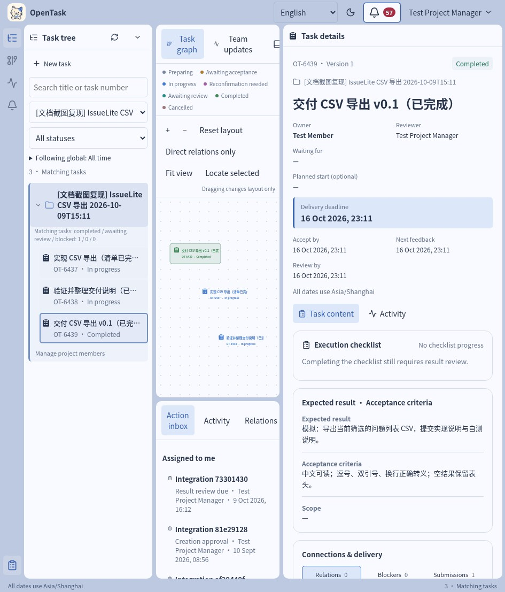

<p align="center">
  
</p>

# OpenTask

### Less chasing updates. More clarity on delivery.

**English** · [简体中文](README.zh-CN.md)

OpenTask is an open-source team task workspace that brings **work agreements, progress and result review** together. See who has accepted the work, what a good result looks like, where things are stuck and who needs to act next—all in the context of the task.

We want team leads to spend less time chasing and relaying updates, and contributors to spend less time guessing expectations. Next, we want AI agents to help carry that day-to-day coordination work alongside people.

**[Try it locally](#try-it-locally)** · [Walk through a delivery](docs/en/CASE-CSV-EXPORT.md) · [What's next](#next-agents-that-connect-tasks-and-conversations) · [Documentation](docs/en/README.md)

**0.1.0-alpha candidate** · Runs locally · Single team · English & 简体中文 · Apache-2.0



*Actual app screenshot with English controls, using a synthetic CSV export example. Task titles and descriptions retain their original Chinese input.*

## Why OpenTask?

“Has anyone picked this up?” “What's blocking it?” “You said it's done—where's the result?”

Everyday questions can turn into repeated trips through chat, meetings and documents. After a few scope changes, people may even disagree on what “done” means.

OpenTask organizes collaboration around a delivery. Agree on the expected result and acceptance criteria before work begins. Record progress and requests for help as work proceeds. Submit the outcome to the agreed reviewer when it's ready. Each task carries the decisions behind its status.

If you lead a small team, coordinate work across several people, or want to turn scattered chat requests into work you can follow through, try it with one small project.

## From “could you handle this?” to an agreed delivery

**1. Agree before starting.** Define the expected result, acceptance criteria, owner, reviewer and deadlines. After creation approval, the owner explicitly accepts the task, giving both sides a clear agreement to work from.

**2. Keep progress in context and help within reach.** Break execution into checklist items, post formal progress and set the next feedback time. Request help when blocked; followups show who needs to act now.

**3. Keep the agreement current.** When scope or deadlines change, the owner confirms the new version. Changes and confirmations stay with the task so the team can revisit the decision.

**4. Deliver a result that someone can review.** Submit an outcome and evidence links for the reviewer to accept or return. Rework continues in the same task, with earlier submissions and return reasons preserved.

The workspace opens with a Gantt chart for planned periods and delivery deadlines. Use the task tree to understand the breakdown, the retained task graph to explore parent/child, prerequisite and related work, and task details to read agreements and history. Filter by project, status, keyword or time, and share a task URL with teammates.

**A detail worth trying: finishing the checklist still leaves the result to be reviewed.** If a prerequisite's result hasn't been accepted, the dependent task's result can't be accepted either. Execution and delivery each have an explicit record.

Switch between English and Simplified Chinese, and between light and dark themes. Language and theme choices persist; task content stays as written. Dates use Asia/Shanghai time.

## Try it locally

This alpha runs from source. You need **Node.js 24 LTS, npm, Docker Engine and Docker Compose**, with ports `4310` for the app and `55432` for PostgreSQL available.

```sh
git clone https://github.com/M1racleShih/open-task.git
cd open-task
npm ci
docker compose up -d --wait db
npm run db:migrate
SEED_PASSWORD='OpenTask-Test-2026!' npm run db:seed
npm run build
npm start
```

In a second terminal, start the background worker from the repository directory:

```sh
npm run worker
```

Open **<http://127.0.0.1:4310/>** and sign in as `leader` with initial password **`OpenTask-Test-2026!`**. Keep both the API and worker running; the worker handles background jobs, including overdue reminders. The interface starts in English; use **Language** at the top to switch to Simplified Chinese.

### On your first visit, try this workflow

1. As `leader`, create a project, assign `manager` as its project manager and add `member` to the project.
2. Create a task called “Collect trial feedback” in that project, with `member` as owner and `manager` as reviewer. Define the expected result, acceptance criteria and required deadlines, then issue the task.
3. Switch to `member`, accept and start the task, record progress and submit an outcome clearly marked as simulated.
4. Switch to `manager` and review against the criteria. Try returning it once, then have `member` improve and resubmit it to see how both submissions are preserved.

Use the account menu to switch users, and copy the task URL to continue as another role. In a new database, `leader`, `manager`, `member`, `other` and `admin` share the initial password above; repeated seeding does not reset existing passwords. `admin` manages accounts and does not automatically gain task approval authority.

Want to explore scope changes, checklist approval, blocker collaboration and prerequisites? Follow the **[CSV export case](docs/en/CASE-CSV-EXPORT.md)** through a simulated delivery with four connected tasks.

To stop, press Ctrl+C in both terminals and run `docker compose stop db`; your data stays in place. See [local setup](docs/en/QUICKSTART.md) for restarts and troubleshooting. Before updating an existing workspace, back it up using [release checks](docs/en/RELEASE-CHECK.md).

## Next: agents that connect tasks and conversations

Much of the effort in task management goes into gathering information, asking for updates, reminding people to respond and copying decisions from chat back into tasks. We want AI agents to take on more of that coordination so people can focus on judgment, collaboration and delivery.

We plan to build an **MCP or CLI interface for OpenTask**, giving agents access to task context so they can help break down work, update progress and assemble delivery materials. We also plan to connect agents to **Feishu**, bringing task management into everyday IM conversations.

| Direction | The experience we want to enable |
| --- | --- |
| **MCP / CLI** | Let agents access agreements, relationships and history from their own working environment, and help move tasks forward. |
| **Agents × Feishu** | Turn conversations into tasks for confirmation, and bring progress, blockers and pending reviews back into the conversation with less manual copying. |
| **People and agents working together** | Let agents assist with followups, summaries and reminders while people retain decisions on key agreements and result acceptance. |

For example, you could eventually tell an agent in Feishu: “Turn this discussion into tasks and send them to the relevant teammates for confirmation.” The agent would help gather updates, surface blockers and prepare results for review, keeping everyone working from the same task agreement.

**This is the product direction, not functionality included in 0.1.0-alpha. Interface details and timing are still to be determined.** If this is how you'd like your team to work, [tell us about your use case](https://github.com/M1racleShih/open-task/issues).

## What to expect from this alpha

This version is for trying a single team's workflow on your own machine. The app and database listen only on localhost by default; remote team access and public deployment need further configuration, development and verification.

Non-draft tasks are visible to the entire team; project membership does not isolate project data. External identity login, file uploads, outbound messaging and AI agent integration are not available yet. Evidence is stored as links. Long-term usability still needs feedback from real teams. See the [release notes](docs/en/RELEASE-NOTES.md).

## Help shape OpenTask

The most useful feedback is a concrete collaboration experience: where the agreement became clearer, where the process added overhead, and which information you still had to find in chat. Share feedback, bugs and ideas in [Issues](https://github.com/M1racleShih/open-task/issues), or contribute code and documentation through a pull request.

| What you want to do | Start here |
| --- | --- |
| Understand roles and the full workflow | [User guide](docs/en/USER-GUIDE.md) |
| Change code and run checks | [Development guide](docs/en/DEVELOPMENT.md) |
| Explore the existing HTTP API | [API v1](docs/en/API.md) |
| Inspect release verification and backup/recovery | [Readiness report](docs/en/RELEASE-READINESS.md) · [Release checks](docs/en/RELEASE-CHECK.md) |
| Browse all documentation | [English documentation home](docs/en/README.md) |

Built with **React + Vite · Fastify · PostgreSQL · pg-boss**. Development checks and offline documentation build:

```sh
npm run typecheck
npm run build
bash scripts/test-db.sh
npm run docs:build
```

Database tests use the dedicated `open_task_test` database; see the development guide for prerequisites and scope. The offline documentation entry is `artifacts/docs/index.html`.

## License

OpenTask is licensed under [Apache-2.0](LICENSE). Third-party resources, including icons, retain their own licenses; see [third-party notices](docs/en/THIRD-PARTY-NOTICES.md).
