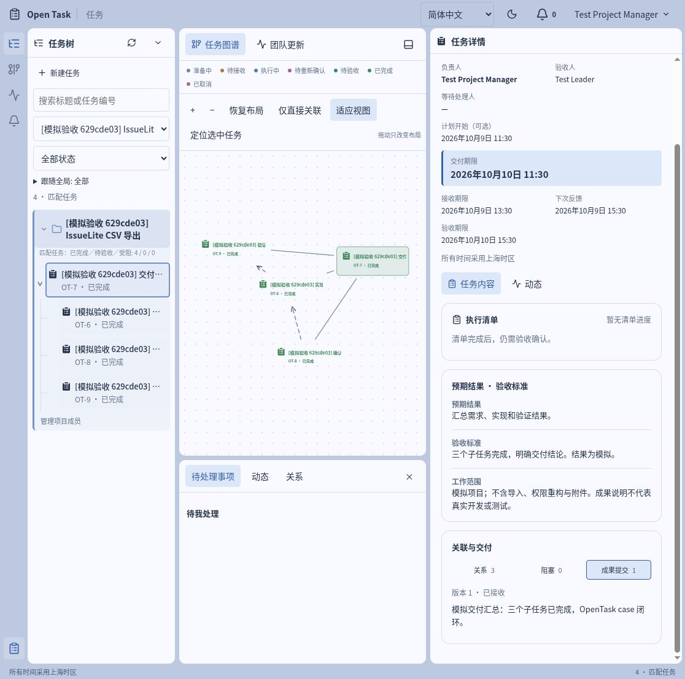

<p align="center">
  
</p>

# OpenTask

### 少一点追问进度，多一点清晰交付。

[English](README.md) · **简体中文**

OpenTask 是一个开源的团队任务协作工具，把**交付约定、执行进展和成果验收**放在同一个工作空间里。谁来做、做到什么程度、卡在哪里、下一步该谁处理，都能围绕任务找到答案。

我们希望让管理者少花时间追问和转述，让执行者少猜需求、多专注工作；未来，让 AI Agent 也能参与其中，为人类分担日常管理的压力。

**[开始试用](#开始试用)** · [看看一次完整交付](docs/zh-CN/CASE-CSV-EXPORT.md) · [未来方向](#下一步让-agent-连接任务与沟通) · [使用文档](docs/zh-CN/README.md)

**0.1.0-alpha 候选版** · 本地运行 · 单团队 · 中英双语 · Apache-2.0



*来自 CSV 导出模拟案例的实际界面：从团队目标到子任务，再到交付成果，在同一处查看。*

## 为什么做 OpenTask

“这件事有人接了吗？”“现在卡在哪里？”“你说完成了，成果在哪？”

这些问题很普通，却会在聊天、会议和文档之间反复出现。需求改过几轮后，大家甚至可能对“完成”有不同理解。

OpenTask 围绕一次交付组织协作：开始前，把预期结果与验收标准说清楚；执行中，把进展和需要的协助留下来；交付时，把成果交给约定的验收人。任务不仅有状态，也有每一次决定的来龙去脉。

如果你正在带一个小团队，需要协调多人交付，或希望把分散在聊天中的工作整理成可跟进的任务，欢迎从一个小项目开始试用。

## 从一句“帮我做一下”，到一次明确的交付

**1. 先约定，再开工。** 写清预期结果、验收标准、负责人、验收人和期限。任务经过创建审批后，由负责人亲自接收，双方有明确的工作约定。

**2. 进展有上下文，阻塞有人接。** 用执行清单拆分步骤，提交正式进展，并记录下一次反馈时间。遇到问题可以提出阻塞协助请求；待处理事项显示当前需要谁行动。

**3. 改了需求，也同步约定。** 范围或期限调整后，负责人确认新版本。变更与确认记录保留在任务中，方便回看当时的决定。

**4. 带着成果交付，按标准验收。** 负责人提交成果说明与证据链接，验收人决定通过或退回。返工继续在同一任务里完成，之前的提交和退回理由仍可查看。

从任务树看工作拆分，从图谱看父子、前置和关联关系，再打开详情查看约定与历史。你可以按项目、状态、关键词和时间筛选，也可以直接分享任务链接给团队成员。

**一个值得亲手体验的细节：清单全部勾完，任务仍需成果验收才能完成。** 前置任务的成果还没通过，依赖它的任务也不能验收通过。OpenTask 让“做过了”和“交付了”各自有清楚的记录。

界面支持中英文切换、浅色／深色主题，语言与主题选择会保存。任务正文保留原始输入，日期按上海时区显示。

## 开始试用

当前 alpha 从源码启动，需要 **Node.js 24 LTS、npm、Docker Engine 和 Docker Compose**。应用端口 `4310`、数据库端口 `55432` 需要空闲。

```sh
git clone https://github.com/M1racleShih/open-task.git
cd open-task
npm ci
docker compose up -d --wait db
npm run db:migrate
SEED_PASSWORD='OpenTask-Test-2026!' npm run db:seed
npm run build
npm start
```

另开一个终端，在仓库目录启动后台 worker：

```sh
npm run worker
```

打开 **<http://127.0.0.1:4310/>**，使用 `leader` 登录，初始密码为 **`OpenTask-Test-2026!`**。API 与 worker 都需保持运行，worker 负责后台任务，包括逾期提醒。界面默认英文，可在顶部 **Language** 切换为简体中文。

### 第一次打开，试试走完这条流程

1. 用 `leader` 创建项目，将 `manager` 设为项目负责人，再把 `member` 加入项目。
2. 在项目中创建一个“整理试用反馈”的任务，负责人选择 `member`、验收人选择 `manager`。写明预期结果、验收标准和必填期限，再发布任务。
3. 切换到 `member`，接收并开始任务，记录进展，再提交一份标注“模拟”的成果说明。
4. 切换到 `manager`，按标准验收。也可以先退回一次，再让 `member` 补充重交，看看两次提交如何保留。

通过顶部账户菜单切换用户，复制任务 URL 即可在不同角色间继续处理。新数据库中的 `leader`、`manager`、`member`、`other`、`admin` 使用相同初始密码；重复初始化不会重置已有密码。`admin` 用于账号管理，不自动获得任务审批权。

想进一步体验需求变更、清单审批、阻塞协作和依赖约束？跟着 **[CSV 导出案例](docs/zh-CN/CASE-CSV-EXPORT.md)**，走完一个包含四个任务的模拟交付。

停止时，在两个终端按 Ctrl+C，再运行 `docker compose stop db`；数据会保留。重启、故障排查见[本地启动指南](docs/zh-CN/QUICKSTART.md)。已有工作区更新前，请先按[发布检查](docs/zh-CN/RELEASE-CHECK.md)备份。

## 下一步：让 Agent 连接任务与沟通

任务管理里最耗精力的，往往是不断整理信息、追问进度、提醒反馈，再把聊天里的决定写回任务。我们希望 AI Agent 能接手更多这类工作，让人把精力用在判断、协作和真正的交付上。

未来计划开发 **OpenTask 的 MCP 或 CLI 接口**，让 Agent 能读取任务上下文、协助拆分工作、更新进展并整理交付材料；再让 Agent 接入**飞书**，把任务管理与 IM 中的日常沟通打通。

| 未来方向 | 希望带来的体验 |
| --- | --- |
| **MCP／CLI** | 让 Agent 在自己的工作环境中获取任务约定、关系和历史，并协助推进任务。 |
| **Agent × 飞书** | 从对话中整理待确认的任务，把进展、阻塞与待验收事项带回沟通现场，减少手动搬运。 |
| **人机协作** | Agent 辅助跟进、汇总与提醒；人类保留关键约定和成果验收的决定权。 |

例如，未来你可以在飞书里告诉 Agent：“把这次讨论整理成任务，发给相关同事确认。”之后，Agent 协助收集进展、发现阻塞、整理待验收成果，让团队沿着同一份任务约定继续协作。

**以上是产品方向，尚未包含在 0.1.0-alpha 中，具体接口与实现节奏仍待确定。** 如果这也是你想要的协作方式，欢迎[分享你的场景](https://github.com/M1racleShih/open-task/issues)。

## 当前 alpha 的边界

这一版适合在本机体验单团队协作流程。应用与数据库默认只监听 localhost；远程团队访问和公网部署还需要后续配置、开发与验证。

非草稿任务对全团队可见，项目成员设置不提供项目数据隔离。当前未提供外部身份登录、文件上传、对外消息或 AI Agent 集成；成果证据以链接保存。真实团队的长期使用体验仍需要试用反馈。详见[版本说明](docs/zh-CN/RELEASE-NOTES.md)。

## 一起把 OpenTask 做得更好

最有帮助的反馈，是一次具体的协作经历：哪一步让约定更清楚了，哪一步增加了负担，哪些信息仍需回到聊天里寻找。欢迎通过 [Issues](https://github.com/M1racleShih/open-task/issues) 提交使用反馈、问题和想法，也欢迎通过 Pull Request 改进代码与文档。

| 想做什么 | 从这里开始 |
| --- | --- |
| 了解角色与完整流程 | [使用指南](docs/zh-CN/USER-GUIDE.md) |
| 修改代码、运行检查 | [开发指南](docs/zh-CN/DEVELOPMENT.md) |
| 了解现有 HTTP 接口 | [API v1](docs/zh-CN/API.md) |
| 查看发布验证与备份恢复 | [发布就绪报告](docs/zh-CN/RELEASE-READINESS.md) · [发布检查](docs/zh-CN/RELEASE-CHECK.md) |
| 阅读全部文档 | [中文文档首页](docs/zh-CN/README.md) |

技术栈：**React + Vite · Fastify · PostgreSQL · pg-boss**。开发检查与离线文档构建命令：

```sh
npm run typecheck
npm run build
bash scripts/test-db.sh
npm run docs:build
```

数据库测试使用专用的 `open_task_test` 数据库；前提与检查范围见开发指南。离线文档入口为 `artifacts/docs/index.html`。

## 许可

OpenTask 采用 [Apache-2.0](LICENSE) 许可。图标等第三方资源保留各自许可，见[第三方声明](docs/zh-CN/THIRD-PARTY-NOTICES.md)。
