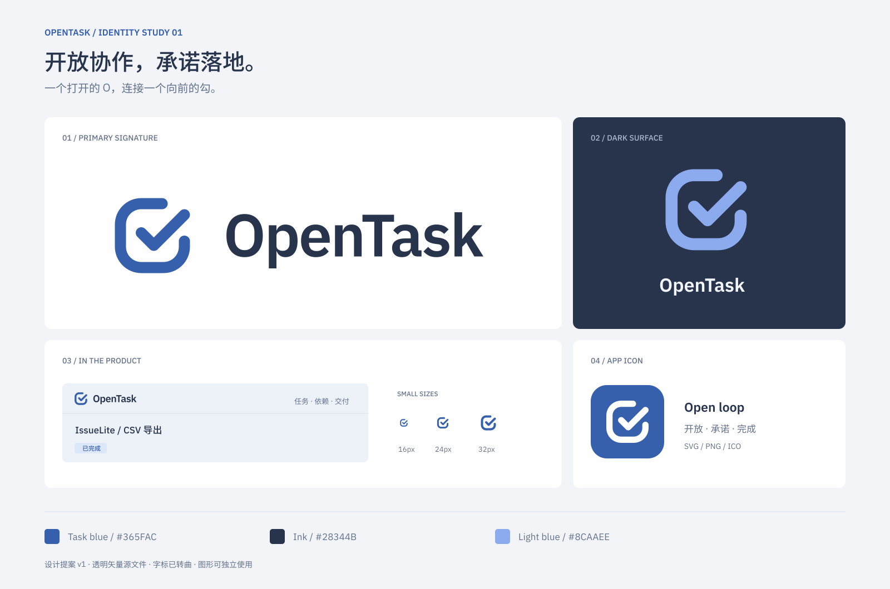

# OpenTask Logo · 提案 v1

## 设计方向

**Open loop：开放协作，承诺落地。**

图形用一个右上方打开的圆角 O 表达 Open，内部向外延伸的勾表达任务完成与交付。开口与勾之间保留间隙，使小尺寸图标仍能分辨两个结构。沿用产品已有的蓝色，适合任务工作台、文档封面与浏览器图标。

字标暂定连写 **OpenTask**。此目录为设计提案，尚未替换产品中的标题、任务图标或 favicon。展示稿中的工作台是应用示意。

## 文件选择

| 场景 | 文件 |
| --- | --- |
| 浅色背景上的完整 Logo | [opentask-logo-light.svg](opentask-logo-light.svg) |
| 深色背景上的完整 Logo | [opentask-logo-dark.svg](opentask-logo-dark.svg) |
| 单色印刷或反白 | [黑色](opentask-logo-black.svg) / [白色](opentask-logo-white.svg) |
| 产品内独立图标 | [蓝色](opentask-mark-blue.svg) / [浅蓝色](opentask-mark-light.svg) |
| 单色独立图标 | [黑色](opentask-mark-black.svg) / [白色](opentask-mark-white.svg) |
| 带底色的应用图标 | [SVG](opentask-app-icon.svg) / [512px PNG](opentask-app-icon-512.png) |
| 浏览器 favicon | [opentask-favicon.ico](opentask-favicon.ico)（16 / 32 / 48px） |
| 编辑字标文字 | [opentask-logo-editable.svg](opentask-logo-editable.svg) |
| 展示与评审 | [HTML 预览](index.html) / [PNG](preview.png) / [SVG](preview.svg) |

完整 Logo 还提供透明 PNG，宽度 1120px。独立图标提供 16、24、32、64、256 和 512px 透明 PNG。

## 使用规范

- 保持原始比例；完整 Logo 的画布比例为 280:64。
- 图形视口为 64×64。建议产品标题栏使用 24–32px；16px 用于 favicon 或紧凑入口。
- 完整 Logo 建议显示宽度不小于 140px；更窄位置只使用图形。
- 四周额外留白建议至少为图形高度的 1/8。例如 32px 图标，额外留白至少 4px。
- 浅色背景使用主蓝与墨色，深色背景使用浅蓝与近白字标。不要直接把主蓝版放在深色背景上。
- 不拉伸、旋转或为图形添加投影。应用图标已有独立底色版本。

| 颜色 | 值 | 用途 |
| --- | --- | --- |
| Task blue | `#365FAC` | 浅色背景主图形，沿用产品 accent |
| Ink | `#28344B` | 浅色背景字标 |
| Light blue | `#8CAAEE` | 深色背景图形，沿用产品 dark accent |
| Near white | `#F2F5FC` | 深色背景字标 |

分发版 SVG 字标已经转为路径，无须用户安装字体。编辑版保留文字，使用 **IBM Plex Sans SemiBold（600）**，字间距 -1.1px；编辑文字时需要安装对应字体。IBM Plex 使用 [SIL Open Font License 1.1](https://github.com/IBM/plex/blob/master/LICENSE.txt)。本目录未附带字体文件。

若把 SVG 内联到页面，给每个实例的 `title` 设置唯一 ID，并同步调整 `aria-labelledby`。装饰用途可由宿主页面设置 `aria-hidden="true"`；图片用途可以使用 ``。

## 本次验证

已用 Inkscape 将字标转曲，使用 librsvg 渲染 PNG 并检查展示稿；检查 SVG XML、透明 PNG 尺寸、favicon 多尺寸，以及 HTML 的本地引用。尚未接入实际产品界面。
