# Advanced case: coordinate a CSV export project

[简体中文](../zh-CN/CASE-CSV-EXPORT.md)

A customer support team uses IssueLite to track issues. They need to export the current filtered list for their weekly review. The developer can write the export, but someone must settle the rules, review the result and check the release notes. This is the delivery we will coordinate in OpenTask.

Complete [your first task](FIRST-TASK.md) first. This case then practices four-person collaboration, approval, blockers, changes and returned results. Allow about 45–60 minutes for the full walkthrough; stop after any numbered step and continue from the task URL.

This is a task-collaboration exercise with synthetic people and IssueLite deliverables. Screenshots show the English interface captured on 2026-10-13; numbered markers identify the controls discussed below. [Screenshots and check records](SCREENSHOTS.md) preserve the scope and results of that run.

## 1. Create the example project

Complete [local setup](QUICKSTART.md), using an [isolated walkthrough database](DEVELOPMENT.md#prepare-an-isolated-database-for-the-tutorial) if you already have a workspace. Sign in as `leader`; the demo password is `OpenTask-Test-2026!`. Use **Account → Switch user** whenever a step names another account. Copy each task URL before switching: it contains the task UUID, so another team account can open the same task.

| Account | Responsibility in this delivery |
| --- | --- |
| `leader` / Test Leader | Approve the commitment and accept the overall delivery |
| `manager` / Test Project Manager | Settle export rules and review implementation and verification |
| `member` / Test Member | Produce implementation and self-test notes |
| `other` / Test Other Member | Prepare verification and delivery notes |

Click **New project** and name it `IssueLite · CSV export`. Select **① Test Project Manager** and **② Test Member + Test Other Member** (use Ctrl/Cmd to select multiple members). Submit the form.


**Check:** the project appears in the task tree. Project membership organizes the team; submitted tasks remain visible to the whole team.

## 2. Write requirements and submit for approval

Switch to `member`. Choose **New task** and enter the following for task **C**:

| Field | Copy or select |
| --- | --- |
| Title | `Implement CSV export` |
| Project | `IssueLite · CSV export` |
| Owner | Test Member |
| Reviewer | Test Project Manager (the default for this owner/project) |
| Expected result | Synthetic walkthrough: export the filtered issue list as CSV, with implementation and self-test notes. |
| Scope | Number, title and status. No import, attachments or permission changes. |
| Acceptance criteria | Preserve filters; readable international text; escape commas, quotes and line breaks; keep headers for empty results. |


**① Owner** accepts and performs the work. **② Reviewer** decides whether the result meets **③ the expected outcome** and acceptance criteria. The creator can be a different person from both.

Scroll down to the dates. Use dates in the future relative to your run, in **Shanghai time**, formatted as `YYYY-MM-DD HH:mm`. The screenshots use this schedule:

| Field | Screenshot value | Meaning |
| --- | --- | --- |
| Planned start | 2026-10-14 09:00 | Optional plan start |
| Accept by | 2026-10-14 10:00 | When the owner should respond |
| Next feedback | 2026-10-14 16:00 | When the next formal update is due |
| Delivery deadline | 2026-10-16 18:00 | When the result should be ready |


Click **③ Submit**. **Check:** the task is **Draft**, visible only to its creator. This button saves the form; it does not issue the task. Open C and choose **Submit for approval → Submit** to make it team-visible and begin approval.

## 3. Complete two levels of creation approval

As `manager`, open C. To practice a correction, choose **Return for editing**, with reason `Please make the empty-result behavior explicit before approval.`

As `member`, open C, choose **Edit draft**, and make the final criterion explicit: `An empty result contains the three column headers and no data rows.` Save, then **Submit for approval** again.

As `manager`, choose **Approve creation → Submit**. The task still says **① Creation approval**, and **② Waiting for** now names **Test Leader**.


As `leader`, open C and **Approve creation**. **Check:** C becomes **Awaiting acceptance**, waiting for Test Member. The task has been approved; its owner must still accept it.

A project manager creating a task in their own project goes directly to the leader. A leader can issue their own draft directly. `admin` has account-management powers, not automatic business approval powers.

## 4. Create parent and child tasks and set prerequisites

As `leader`, create and **Issue task** for A, B and D. Use the same future schedule and these assignments; saving each form still creates a draft first.

| Label | Title | Owner → reviewer | Expected result and acceptance criteria |
| --- | --- | --- | --- |
| A | Deliver CSV export v0.1 | manager → leader | A delivery summary referencing the accepted rules, implementation and verification |
| B | Confirm export rules | manager → leader | Three columns, current filters, encoding, escaping and empty-result behavior are explicit |
| C | Implement CSV export | member → manager | Already created in steps 2–3 |
| D | Verify and prepare delivery notes | other → manager | Notes cover filters, international text, commas, quotes, line breaks and empty results |

In each child's **Task content → Connections & delivery → Relations → Add relation**, select A as **Primary parent** and explain its contribution. Then, in C, add B as **Prerequisite**; in D, add C as **Prerequisite**.


**① Target task** selects the prerequisite task that provides the result you need. **② Prerequisite** means that result must be accepted before this task can pass review. It does not prevent work from starting.



The tutorial diagram shows **acceptance order**. In the application's graph, a prerequisite arrow points from the dependent task to the prerequisite it needs. Parent/child structure answers “what contributes to this goal?”; dependencies answer “which result must be accepted first?”.


Read the workspace from **① the task tree**, through **② the relation graph**, to **③ the selected task**. **④ Action inbox** tells each person what needs a response. Selecting a graph node and selecting its tree row open the same record. Dragging a graph node changes its layout only.

## 5. Accept the task and request a checklist

As `member`, open C and choose **Accept task → Submit**. It becomes **Accepted**. Then **Start work → Submit** makes it **In progress**. **Accept and start** is the shortcut when both decisions happen together.

Choose **Request checklist edit** (called **Request checklist change** in the dated capture). Enter one item per line:

```text
Export currently filtered results
Document encoding and CSV escaping
Cover empty results and six verification cases
```

Reason: `Break the agreed result into visible execution steps.` Leave **Changes scope or acceptance criteria** unchecked.


**① These are proposed steps**, not an immediately active checklist. **② The unchecked box** says this is a breakdown of already agreed work. As `leader`, open C and **Approve checklist**. Back as `member`, refresh: the checklist now has three unchecked items.

## 6. Report a blocker and request help

As `member`, choose **Report blocker**:

- Reason: `The empty-result header behavior needs confirmation.`
- Help needed: `Confirm whether an empty export keeps all three column headers.`
- Helper: **Test Project Manager**.


**① State the decision you need**, and **② assign a helper** so it becomes actionable. As `manager`, open C, select **Connections & delivery → Blockers → Reply to blocker**, and reply `Keep number, title and status as headers, with no data rows.`


As `member`, use **Resolve blocker**, explaining `The header behavior is now clear; continuing the implementation notes.` **Check:** the blocker and reply remain in history. Reporting or resolving it does not move the delivery deadline or replace formal progress.

## 7. Change requirements and confirm the new version

As `member`, choose **Request agreement change**: `Specify UTF-8 BOM so exported international text opens correctly in Excel.`

As `leader`, open **Adjust agreement**, add `Include UTF-8 BOM for Excel` to the acceptance criteria, set a future **① Confirm adjustment by** date and **② explain the change**. Submit.


As `member`, open C. Under **Confirm this version → Agreement changes**, read the before/after agreements. The version number has increased; the previously accepted task agreement remains visible until you confirm.

Try **Submit result** before confirming: enter a short result and a future **Review by** date. The server keeps the form open with this message:


Close that form with **Discard form**, then **Confirm this version → Submit**. **Check:** the confirmation followup disappears. Changing an agreement records a new version; merely changing a checklist checkmark does not.

## 8. Report progress and save the checklist

As `member`, choose **Record progress**:

| Field | Example |
| --- | --- |
| Current result / message | Synthetic progress: filtered export and encoding notes are ready. |
| Next step | Add escaping and empty-result verification notes, then request review. |
| Next feedback | A future time, such as 2026-10-15 14:00 in this run |


These three fields let another person understand what exists, what comes next and when to expect news. **Add comment** is available for discussion, but a comment does not satisfy or postpone formal feedback.

Check all three checklist items and click **Save checked progress** (called **Confirm submission** in the dated capture). Unsubmitted checks are local edits. Refresh to see the saved state:


**① In progress + ② 3/3, 100% is correct.** The checklist describes execution; the reviewer still needs to examine the delivered result.

## 9. Submit a result and review deadline

As `member`, choose **Submit result**. Enter:

```text
Synthetic result v1: filtered export and UTF-8 BOM are documented.
Special-character evidence is still missing.
```

Set a future **Review by** time. Evidence links are optional. Add HTTP(S) links when you have supporting material, or leave them empty for this exercise.


**① Describe what was delivered. ② Link to real evidence when available. ③ Say when a review is needed.** OpenTask stores text and HTTP(S) links; it does not upload files or verify their contents. **Check:** the task becomes **Awaiting review**, waiting for Test Project Manager.

## 10. Check the prerequisite and return an incomplete result

Keep B unfinished. As `manager`, try **Accept result → Submit** on C.


**Check:** acceptance is rejected and C stays **Awaiting review**. Close the form. Choose **Return result**, give the reason `Add verification notes for commas, double quotes, line breaks and empty results.`, and set a future **Next feedback** time.


After submission, C is **In progress** again. The return gives the owner a concrete next action. It keeps the first result and review decision in the same task.

## 11. Complete the prerequisite and resubmit the result

As `manager`, open B and **Accept and start**. **Submit result** with the agreed columns, filters, UTF-8 BOM, escaping and empty-result rules. As `leader`, **Accept result** on B.

As `member`, submit C again:

```text
Synthetic result v2: notes now cover filters, international text,
commas, double quotes, line breaks and empty results.
This is an OpenTask workflow rehearsal, not a shipped IssueLite feature.
```

Set a future review deadline. As `manager`, **Accept result**. Under **Connections & delivery → Submissions**, both decisions remain:


**Check:** C is **Completed**. One submission is **Returned**, the next is **Accepted**. Both can use the same agreement version while remaining separate submissions.

## 12. Summarize child results and review the parent

As `other`, **Accept and start** D, then submit the six-category verification and delivery notes, clearly marked synthetic. As `manager`, accept D's result.

Now B, C and D are complete. **A has not completed itself.** As `manager`, accept/start A and submit a summary referencing the three accepted child results. As `leader`, accept A.


**① The parent has its own review. ② All four tasks now read Completed.** Reopen C by its URL and refresh: its versions, submissions and relations remain. A completed task cannot reopen; later fixes get a new related task.

## 13. Adjust and cancel a follow-up task

The team now asks about CSV import. Stay in the same project and create **E: Explore CSV import follow-up**, owner `member`, reviewer `manager`. Its expected result is a **feasibility proposal**, not an implementation. Issue it and add a **Related task** link to C. This records context without creating an acceptance dependency.

Walk through the following planning conversation:

1. As `member`, choose **Unable to accept** and explain the capacity conflict. E remains Awaiting acceptance; the issuer must respond.
2. As `leader`, **Adjust agreement**, transfer ownership to Test Other Member, and explain why. As `other`, **Accept and start**. A new owner accepts anew.
3. As `other`, request a checklist containing `Build a complete CSV import engine`. As `leader`, **Reject checklist** because only a proposal was agreed. The rejected proposal stays recorded, while the current checklist is unchanged.
4. As `other`, request `Compare import options` and `Document permission and validation risks`. Mark **Changes scope or acceptance criteria** to add the risk review. As `leader`, approve with a confirmation deadline; as `other`, confirm the new version.
5. As `other`, request agreement change to include implementation this week. As `leader`, use **Close adjustment request with response** to explain that implementation needs a separate decision. Closing a request alone does not change the agreement.
6. As `other`, submit a proposal for review. As `leader`, adjust acceptance criteria to require an effort estimate. E returns to **In progress** and the pending submission becomes **Superseded**. A revised result would require confirmation and resubmission.
7. As `leader`, use **Title** to rename E `Assess CSV import for a later release`, then **Cancel task**, explaining that the team has deferred import. E becomes **Cancelled** and keeps its decisions and relation to C.


In the issuer’s view, **① Awaiting acceptance** means the owner has not accepted the task, and **② Waiting for** names the leader. Open the issuer’s Action inbox to handle the refusal.


This branch shows how OpenTask records a change of plan. Cancellation ends the task; it does not erase the conversation or count as completing a prerequisite.

## 14. Practice search, filters and activity views

Continue with the same project in [the user guide](USER-GUIDE.md): search for C by title/number, filter completed work by time, inspect activity, change project color, use the mobile layout and inspect account management. A private, undated **Temporary tasks** draft called `Collect feedback for the next iteration` demonstrates work that is not ready for a project yet.

See [features and controls](FEATURES.md) for explanations of other features.

## Read the records retained in the task

Open C's activity and submissions to see when its owner accepted the task, how requirements changed, what help was requested, why the first result was returned and who accepted the second.

This case does not build or ship a real CSV feature. To check an OpenTask candidate, follow [release checks](RELEASE-CHECK.md). Earlier results remain in the [historical case report](RELEASE-CASE-RESULT.md).
