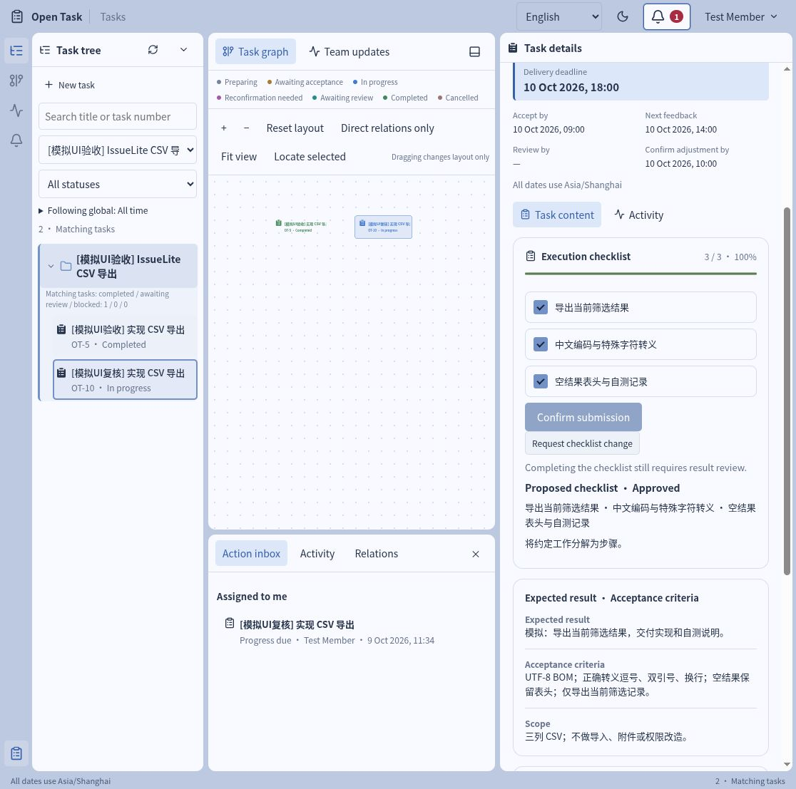
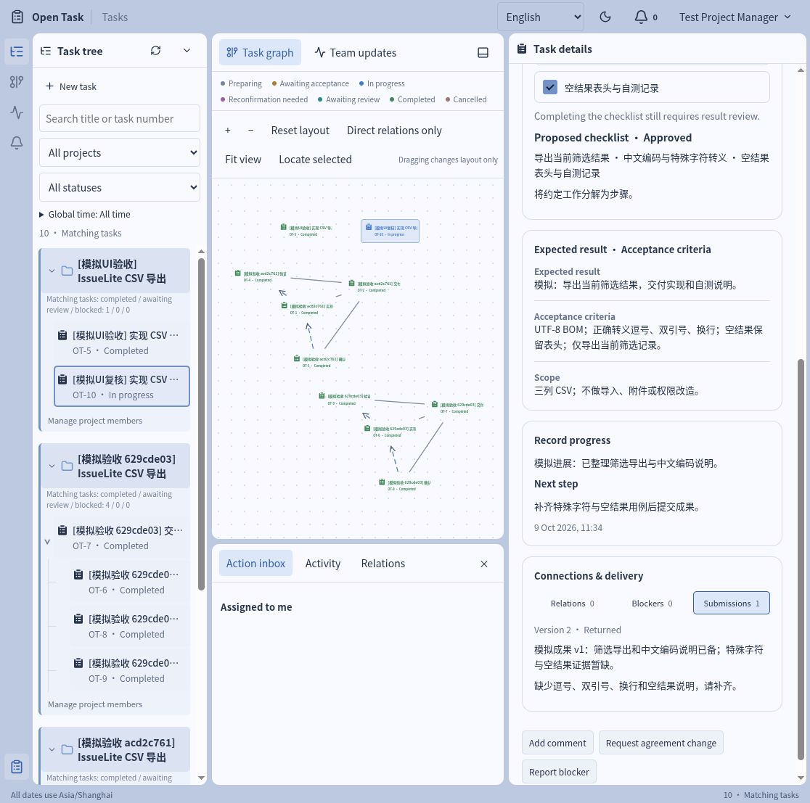

# Case: delivering a CSV export feature

[简体中文](../zh-CN/CASE-CSV-EXPORT.md)

This case simulates a development iteration for IssueLite, a small issue tracker: users want to export the currently filtered issue list as CSV. Four tasks organize the delivery and check whether OpenTask supports the full process from creation approval and task acceptance to result review.

When following along, mark all results as "synthetic" and use no real business records. This case verifies only the OpenTask task workflow; it does not develop a real CSV feature. Written implementation and test-case descriptions are not software test evidence.

## Goal, scope and acceptance criteria

The synthetic requirement exports three columns—number, title and status—while preserving the current filter. Chinese text must display correctly; commas, double quotes and line breaks must be escaped; an empty result must retain headers. CSV import, attachments, permission changes and complex reports are out of scope.

After following the case, check that OpenTask meets these requirements:

- Each role can perform its assigned operations and cannot exceed its permissions.
- Formal progress, execution checklists, agreement versions and result submissions are saved separately.
- Returned results retain their original submission and return reason, and can be resubmitted.
- A dependent task cannot pass review until its prerequisite has completed review.
- All four tasks end as Completed, and records remain after a page refresh or service restart.

## Task breakdown

Use A, B, C and D to identify the four tasks throughout the case.

| Label | Title                             | Owner   | Reviewer | Result                                             |
| ----- | --------------------------------- | ------- | -------- | -------------------------------------------------- |
| A     | Deliver CSV export v0.1           | manager | leader   | Delivery summary referencing the three child tasks |
| B     | Confirm export rules              | manager | leader   | Fields, encoding, escaping and empty-result rules  |
| C     | Implement CSV export              | member  | manager  | Implementation and self-test descriptions          |
| D     | Verify and prepare delivery notes | other   | manager  | Six test-case descriptions and delivery conclusion |

A is the delivery goal; B, C and D are its child tasks. They also have prerequisites: B's rules are required for acceptance of C, and C's implementation is required for acceptance of D.


Dashed lines show parent/child structure. Thick solid lines show acceptance order from prerequisite results to dependent tasks. C and D may start early, but their prerequisites must be complete when results are accepted. These arrows explain the relations; they do not show the API's sourceId / targetId storage direction.

The task tree and setup are:

```text
A Deliver CSV export v0.1
├── B Confirm export rules
├── C Implement CSV export
└── D Verify and prepare delivery notes

Prerequisite result order: B → C → D
Setup: select B as a prerequisite in C; select C as a prerequisite in D.
```

A is only the parent, not a prerequisite of B, C or D. Parent/child structure explains decomposition, rather than completion order.

## 1. Prepare the environment and roles

Follow "Using an isolated case environment" in [local setup](QUICKSTART.md). If you have run `npm run case:check`, the database already contains completed API example tasks. For a manual walkthrough, create a new project marked `[Synthetic walkthrough]`, preserving existing examples and verification records.

leader, manager, member and other are test usernames; account details are in local setup. The initial interface is English and can switch to Simplified Chinese. The instructions and embedded screenshots below use English controls. Task text in the recorded screenshots remains as originally entered in Chinese. Chinese-interface verification screenshots are provided as labeled links.

To switch roles, use Account → Switch user at the top, then log in as the required account. Copy the task URL and reopen it after switching accounts to continue working on the same task.

## 2. leader creates a project

Log in as leader, click New project and enter:

- Name: `[Synthetic walkthrough] IssueLite CSV export`.
- Project manager: Test Project Manager.
- Project members: Test Member and Test Other Member.

After submission, the project should appear on the left.

## 3. member creates C and submits it for approval

Log in as member, click New task, select the new project and choose Test Member as owner. The reviewer should default to Test Project Manager. Enter:

| Field               | Content to copy                                                                                                  |
| ------------------- | ---------------------------------------------------------------------------------------------------------------- |
| Title               | `[Synthetic walkthrough] Implement CSV export`                                                                   |
| Expected result     | Synthetic: export the currently filtered issue list as CSV; submit implementation and self-test descriptions.    |
| Scope               | Number, title and status only; no import, attachments or permission changes.                                     |
| Acceptance criteria | Readable Chinese; correct escaping of commas, double quotes and line breaks; headers retained for empty results. |

Use the schedule below. D0 is the demo day and D1 is the next day. Replace these with actual future dates in Shanghai time, using `YYYY-MM-DD HH:mm`.

| Time field        | Suggested value    |
| ----------------- | ------------------ |
| Planned start     | D0, or leave empty |
| Accept by         | D1 09:00           |
| Next feedback     | D1 12:00           |
| Delivery deadline | D1 18:00           |

Submit in the new-task form saves only a draft. Open the task, confirm Draft status, then choose Submit for approval → Submit. The task becomes team-visible only after submission for approval.

`npm run case:check` uses times relative to when it runs instead of the fixed tutorial dates, which would otherwise make tasks overdue.

## 4. manager and leader approve in sequence

First log in as manager, open C, inspect its expected result, acceptance criteria and dates, then choose Approve creation → Submit.

At this point, **the task should still be in Creation approval, with Test Leader as the current handler**. The team leader must give final approval after the project manager.

Log in as leader, open the same task and choose Approve creation. It should become Awaiting acceptance, with Test Member as the current handler.

One point to check in this step: admin manages accounts and should not be a business approver at any level.

## 5. leader creates A/B/D and adds relations

As leader, create A, B and D from the task table. Fill in their expected results, acceptance criteria and complete schedules, explicitly selecting the listed owners and reviewers. After saving drafts, choose Issue task. These tasks created by leader can be issued directly, without the two-level approval used for member-created tasks.

Under Connections & delivery → Relations → Add relation, configure the following and give a reason for each:

- In B, C and D, select A as Primary parent.
- In C, select B as Prerequisite.
- In D, select C as Prerequisite.

Switch to manager, accept and start A, and leave its final summary and review until the end. The tree and graph should show all four tasks with parent/child and prerequisite relations. Dragging graph tasks changes only layout, not relations.

## 6. member accepts C and requests a checklist

As member, open C and choose Accept and start. The task should become In progress, showing that its owner accepted the agreement and began work.

Choose Request checklist change, entering one item per line:

```text
Export the currently filtered results
Chinese encoding and special-character escaping
Empty-result headers and self-test record
```

For the reason, enter "Break down agreed work without changing acceptance scope". Leave the scope or acceptance-criteria change option unchecked.

After requesting the change, the current checklist should still be empty. Switch to leader, open C from Followups and choose Approve checklist. Refresh after approval; the three items should appear with 0/3 complete.

## 7. Clarify encoding rules and confirm the new version

As leader, open C and choose Adjust agreement. Add "Chinese files include a UTF-8 BOM" to acceptance criteria, explain "Clarify the encoding required for Chinese files opened in Excel", and enter a future adjustment confirmation deadline.

Switch to member and open the same task. The agreement version should have increased and Confirm this version should be available. Read the differences and confirm the new version.

Check two restrictions: an operation using an old version conflicts; even after reading the latest version, results cannot be submitted before confirming it. This adjustment changes acceptance criteria, not checklist content. Agreement and checklist versions record their own changes separately.

### Optional: practice blocker collaboration

To try blocker handling, complete this exchange:

1. member chooses Report blocker: reason "Need confirmation of empty-result headers", help "Confirm the exact output", helper manager.
2. manager chooses Reply to blocker under Blockers and responds "Keep the three-column header with no data rows".
3. member chooses Resolve blocker.

Resolving a blocker does not automatically change task deadlines.

## 8. Save formal progress and checklist completion

As member, choose Record progress and enter:

```text
Current result: Synthetic progress: filtered-export notes prepared; adding special-character cases.
Next step: Complete descriptions for six verification categories, then submit for review.
Next feedback: D1 14:00 (replace with an actual date)
```

Check all three checklist items and choose Confirm submission to save. Completion should show 3/3 and 100%, but **the task should remain In progress**. The checklist records execution progress; the reviewer still decides completion.



A Chinese-interface screenshot captured on 2026-10-10 after reopening synthetic task OT-6437 in the isolated test database: [all three checklist items are saved as complete while the task is still in progress](../assets/release-case/checklist-zh-CN.png). It illustrates this step's state and is not part of the historical verification run.

## 9. Submit the first result, check prerequisites and return it

As member, choose Submit result. Enter "Synthetic result v1: filtered export and Chinese encoding described; special-character evidence is still missing", with Review by set to D1 19:00. Evidence links can remain empty; do not invent PR or test-report links.

Keep B unfinished for now. Switch to manager and attempt Accept result on C. The system should report an unfinished prerequisite; C should remain Awaiting review. This checks the constraint: C can execute early, but cannot pass review before B is accepted as complete.

As manager, choose Return result with reason "Missing verification descriptions for commas, double quotes, line breaks and empty results; please add them", and Next feedback set to D1 16:00.

C should return to In progress. Submissions should retain the first result and return reason.



A Chinese-interface reproduction of the same step: [the first submission and return reason remain](../assets/release-case/returned-zh-CN.jpg).

## 10. Complete the prerequisite, resubmit and accept

As manager, accept and start B, then submit "Synthetic rules: three columns, UTF-8 BOM, CSV escaping and empty-result headers". Switch to leader and accept B's result.

As member, choose Submit result again in C and enter:

```text
Synthetic result v2: descriptions now cover filtering, Chinese text, commas, double quotes, line breaks and empty results.
This case verifies only OpenTask; no real CSV software has been developed.
```

Enter a future review deadline, then have manager accept the result. C should show Completed, with no execution followups. Submissions should retain one returned record and one accepted record.

Both submissions can use the same agreement version, but each remains a separate record.

Original verification screenshot (Chinese interface): [completed status and result records](../assets/release-case/completed.jpg).

## 11. Test delivery and complete the parent

As other, accept and start D and submit "Synthetic delivery notes: rules and implementation accepted; six case categories summarized; verifies only OpenTask". Have manager accept its result.

After B, C and D complete, A should remain unfinished. As manager, submit the delivery summary in A; only after leader accepts it does A complete.

Select this project, all statuses and all time. You should see four completed tasks. Activity should retain actors, versions and results. Refresh, log out and log in again; states, relations and results should remain.

Completed tasks cannot reopen. Create a new task related to the original if a defect is found later.

## Automated checks and evidence

`npm run case:check` automatically runs this business flow through the HTTP API, checking permission errors, idempotent retries, version conflicts, prerequisite rejection, submission history, and behavior after API and worker restarts. It does not control a browser and cannot replace a manual interface walkthrough.

See the [verification report](RELEASE-CASE-RESULT.md) for the separate coverage of the four-task automated case and three-role interface walkthrough. Use [release checks](RELEASE-CHECK.md) to decide release readiness.
