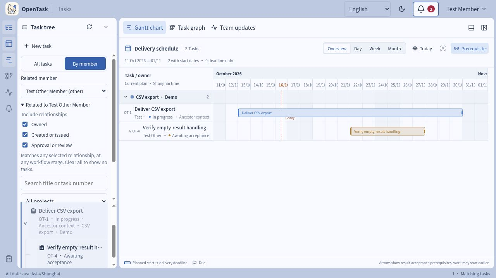
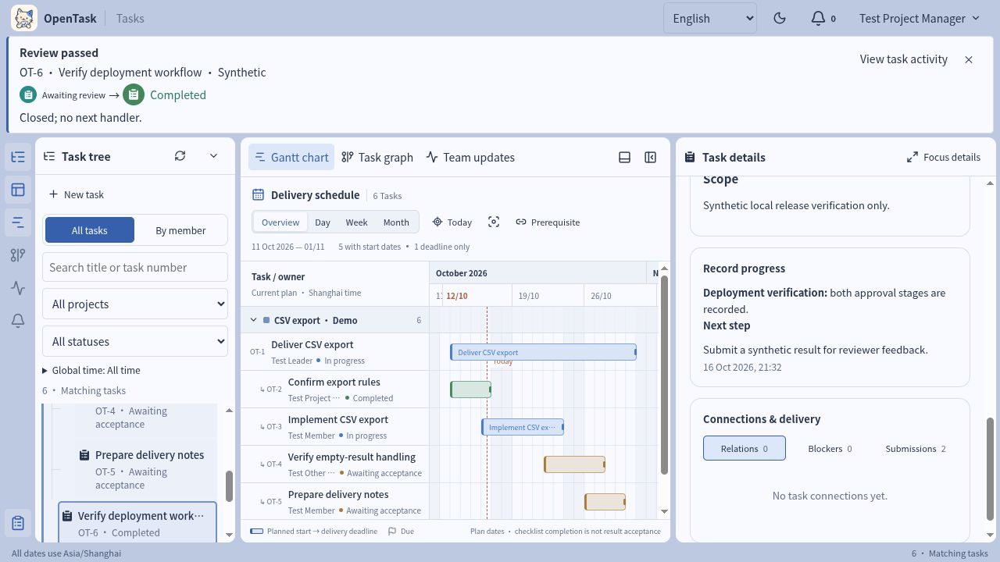

# Release notes

[简体中文](../zh-CN/RELEASE-NOTES.md)

The latest tagged prerelease is **[0.1.2-alpha](https://github.com/M1racleShih/open-task/tree/v0.1.2-alpha)**. Entries below explain what changed for users and where to try it. Dates use Asia/Shanghai. Unreleased changes have no assigned version or release date.

## Unreleased

These application changes are merged into `mvp` after `v0.1.2-alpha`, through [`143e9e7`](https://github.com/M1racleShih/open-task/commit/143e9e769f4bf34da332c03b1a95d2cc999cfcec). They are not in the tagged 0.1.2-alpha source. The refreshed README workspace and stage-feedback capture use the integrated source based on `143e9e7`; the earlier member-filter and checklist captures retain their `369d9ab` provenance.

### Everyday work

| Improvement | What you can do now | Try it |
| --- | --- | --- |
| Filter by a chosen member | Select yourself or another member, combine owner, creator/issuer and approval/review relationships, and keep that selection after refresh or signing in again in this browser. Viewing permissions still apply. | [Member filters](USER-GUIDE.md#filter-tasks-by-member) |
| Read and write task descriptions | Read expected results, criteria and scope in separate sections. Use Edit/Preview and formatting controls for Markdown; expand a long scope when needed. | [Task details](USER-GUIDE.md#read-a-task-before-acting) |
| Know whether checklist progress is saved | See saved progress separately from unsaved checks, undo unsaved changes, and get saving, success or failure feedback beside the checklist. Pending proposals and earlier change records are separate. | [Checklists and progress](USER-GUIDE.md#keep-execution-discussion-and-feedback-clear) |
| Understand action results | See the task, resulting stage and next handlers after workflow actions. Detected teammate changes can show the actual actor and event time when that history is available; open task activity for the full record. | [Action feedback](USER-GUIDE.md#check-the-action-inbox-and-operation-history) |
| Arrange the workspace | Toggle the tree, center workspace, details and bottom panel independently. Focus on task details, restore the previous layout and keep panel visibility and sizes per account in this browser. | [Panels and filters](USER-GUIDE.md#search-and-filter-by-project-status-and-time) |

The 2026-10-16 captures use synthetic English tasks in an isolated local database. Also view the [saved checklist progress](../assets/updates/2026-10-16/checklist-progress-en.jpg) and [Gantt workspace](../assets/updates/2026-10-16/workspace-current-en.jpg). The [capture manifest](../assets/updates/2026-10-16/manifest.json) records the source commit, environment and checks; the [2026-10-13 walkthrough](SCREENSHOTS.md) retains its original evidence.

The [current capture record](../assets/updates/2026-10-16/current-manifest.json) also records the three-role browser rehearsal, including return, resubmission and retained results after refresh.

### Documentation and deployment support

This update also adds [everyday collaboration Q&A](FAQ.md), refreshed English screenshots and corresponding Chinese/English operating instructions. Maintainers can configure whether a deployment exposes API descriptions; see [documentation maintenance](MAINTAINING.md#hide-api-documentation-on-a-team-deployment). These changes are included in Unreleased and are not assigned to a new tag.

## 0.1.2-alpha · 2026-10-16

- **Related to me filters:** combine **Owned**, **Created or issued** and **Approval or review** scopes to find your work across workflow stages. A task matching several scopes appears once; clearing every scope shows no matches.
- Relationship filtering works together with project, search, status and time filters across the tree, Gantt, graph and team activity. Visible parents remain context without increasing the matching count; followups remain available.

This tag filters relationships to the signed-in user. Selecting another member and remembering the selection are subsequent changes described under Unreleased. [Compare with 0.1.1-alpha](https://github.com/M1racleShih/open-task/compare/v0.1.1-alpha...v0.1.2-alpha).

## 0.1.1-alpha · 2026-10-16

- **Gantt planning:** the workspace opens with a delivery schedule, retaining the task graph alongside it. Use Overview/Day/Week/Month scales, Today, Locate selected, project groups and optional prerequisite arrows. Read planned ranges, deadline-only markers, lifecycle colors and overdue/blocker indicators. [Use the Gantt chart](USER-GUIDE.md#read-the-delivery-schedule).
- **Calendar date selection:** choose dates using a calendar or keep typing them. Date/time fields retain 24-hour input and Asia/Shanghai semantics.
- **Readable progress:** the current result and next step render Markdown, including lists and emphasis.
- **Easier checklist requests:** a reason is optional for changes that keep the agreed scope and criteria, and required when those change. Larger, resizable text fields make longer requests easier to edit.

[Compare with 0.1.0-alpha](https://github.com/M1racleShih/open-task/compare/v0.1.0-alpha...v0.1.1-alpha).

## 0.1.0-alpha · 2026-10-10

The first source prerelease for developers to install and try a local, single-team task workspace included:

- Creation approval, explicit owner acceptance, execution and reviewer acceptance.
- Approved checklists, formal progress, blocker collaboration and version confirmation after agreement changes.
- Return and resubmission in the same task, preserving earlier results and reasons.
- Parent/child, prerequisite and related tasks; task tree, graph, team activity and role-specific followups.
- Planned dates and personal time filters with global and project settings.
- English and Simplified Chinese UI and offline documentation, light/dark themes and the OpenTask cat branding.
- PostgreSQL persistence, recoverable background jobs, migrations, backup and isolated restore checks.

## Install and upgrade

Use Node.js 24, npm, Docker Engine and Compose. Follow [local setup](QUICKSTART.md); run both API and worker. Source installation uses `npm ci`, migrations and a production build. Choose a tag for the corresponding version, or `mvp` for merged development changes. `private: true` is retained; OpenTask is distributed as source rather than an npm package.

For existing workspaces, stop writes and the worker, back up and verify an isolated restore before migration. Keep the old code version. See [release checks](RELEASE-CHECK.md). Restore comparisons include nonempty time preferences, sessions, idempotency records and worker health, as well as business tables and queued jobs.

## Scope and known limits

The API and database listen only on localhost. Sessions target local HTTP. Public HTTPS, reverse proxies, remote team access and production use require separate work and verification.

Non-draft tasks are visible to the whole team. This version has no enterprise LDAP directory login, no upload storage, no outbound messaging, and no model or AI Agent integration. Evidence links preserve URLs; the remote files they point to are not backed up. Human usability acceptance and sustained real-team trials remain open.

Seed accounts and their documented password are synthetic local test identities. Do not expose this setup to a public network. Backups and session material are private operational data and are not release attachments.

## License

OpenTask is licensed under [Apache-2.0](../../LICENSE). Existing icon licenses remain in their original form; see [third-party notices](THIRD-PARTY-NOTICES.md).

## Verification

Use [release checks](RELEASE-CHECK.md) to reproduce the checks. The [candidate readiness report](RELEASE-READINESS.md), [case report](RELEASE-CASE-RESULT.md) and [walkthrough record](SCREENSHOTS.md) preserve their original dates and scope; they do not certify later versions. The new screenshot run checked the operations listed in its [manifest](../assets/updates/2026-10-16/manifest.json), without repeating the full release, backup/restore or load checks.
