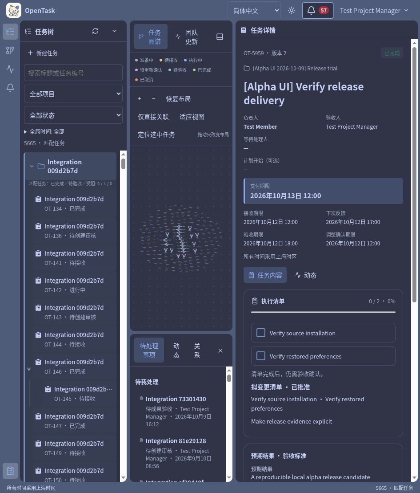
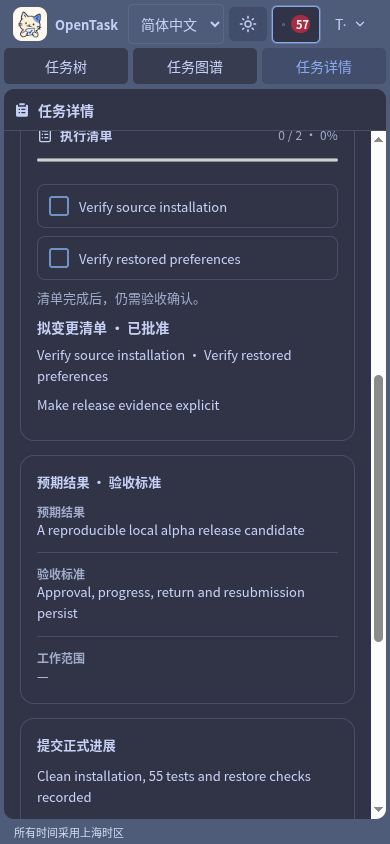

# Alpha candidate readiness

[简体中文](../zh-CN/RELEASE-READINESS.md)

Verified on 2026-10-09 (Asia/Shanghai), under Node 24.18.0 and npm 11.8.0. Candidate version: `0.1.0-alpha`; project license: Apache-2.0. Base commit: `c51e608e3faf01e7a7d022699b317b7a11283811`, plus the release preparation, bilingual documentation, branding and dependency changes in this candidate. This is evidence for the candidate tree, not for the base commit alone.

## Verification scope

This report records technical checks of the `0.1.0-alpha` candidate source in a local, single-team environment. Long-term usability still requires real-team trials.

## Current checks

| Check | Result |
| --- | --- |
| Clean source installation | Copied tracked and non-ignored candidate files into a new directory without node_modules or dist; `npm ci` passed |
| Type checking and production build | Both exited 0; Vite 8.2.2 |
| Unit, documentation and PostgreSQL regression | 55 passed, 0 failed, 0 skipped |
| Four-task HTTP case | 13 assertion groups passed, run `20befa7f` |
| API and worker recovery | Case verified persisted data, sessions, queued work and new worker heartbeat after restart |
| Case backup and restore | All 11 application tables plus pgboss.job matched counts and canonical content |
| Restore regression | Nonempty global/project preferences restored; changing preference content without changing row count made the shared comparator fail |
| Full dependency audit | 0 known vulnerabilities, including development dependencies |
| Bilingual documentation | Offline HTML built with translated page pairs, local links and diagram sources validated |
| Current UI | In-app browser used the isolated open_task_test database on port 4319; three-role workflow passed |
| Responsive and browser errors | Chinese direct link and language survived reload; 390px viewport had scrollWidth 390; browser error log empty |

The UI task was `[Alpha UI] Verify release delivery`, OT-5959. It passed member creation → manager approval → leader approval → acceptance/start → checklist request/leader approval → agreement adjustment/version 2 confirmation → formal progress → first result → return → second result → final acceptance. Both submissions remained readable. This run tested checklist approval; it did not claim a 100% checklist completion check. The existing API regressions cover checklist completion semantics.

## Repairs and evidence

Project and lockfile versions now agree on `0.1.0-alpha`. Apache-2.0 is included in the root LICENSE, with separate icon notices retained. The normal and case restore scripts share one read-only 12-table content comparator. The case saves nonempty personal preferences before taking its backup.

Clean installation exposed the development dependency advisory GHSA-68fv-2mgg-jv7q. The lockfile received a targeted source-map-js patch from 1.2.1 to 1.2.2; a second clean `npm ci`, typecheck, build, all 55 tests, full audit and case/restore passed afterward. Earlier Fastify and indirect dependency patches remain included.

The SHA-256 of the sorted per-file source manifest at verification time was `3d2ea6519528d9e73c275fdf205bfeb7d5130a2d6d333c17eb09ea1ff3777bc9`; it excludes this paired report and its screenshots to avoid a self-reference. This digest identifies the candidate files at verification time; it does not establish verification of later changes.

## Reproduction and limits

See [release checks](RELEASE-CHECK.md) for commands and prerequisites, and [release notes](RELEASE-NOTES.md) for version scope. Later relevant changes require affected checks to run again; this report is not evidence for later source trees.

This was a clean source-directory installation on the current host with its existing PostgreSQL container, not a brand-new-machine or public-hosting test. There was no new load test, real-team trial or normal-workspace backup exercise. Synthetic recovery does not replace checking the actual backup before upgrading an existing workspace. Public HTTPS, remote team access and integrations remain outside this alpha.
