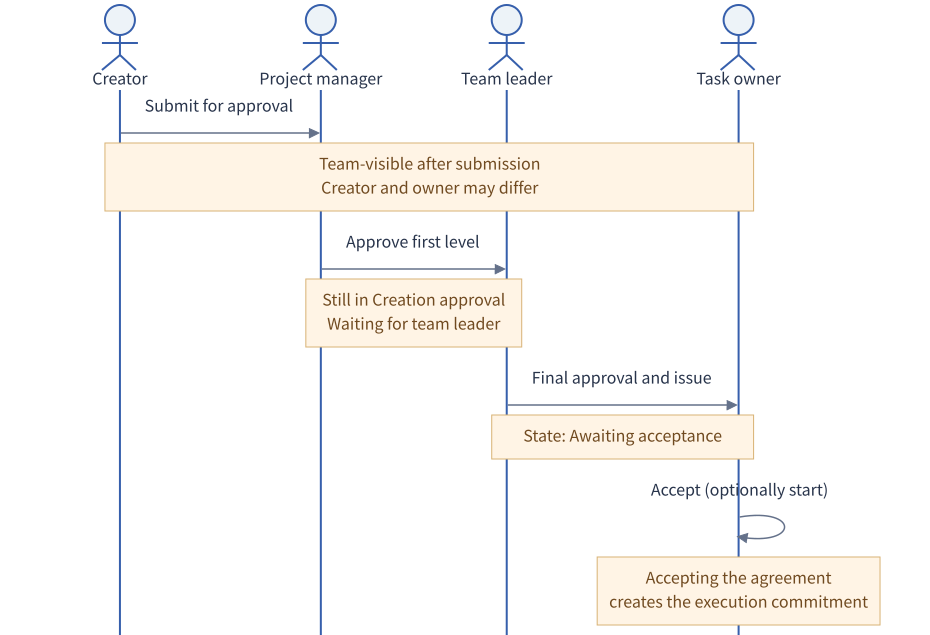

# User guide

[简体中文](../zh-CN/USER-GUIDE.md)

## Roles and visibility

The team leader creates projects, issues tasks, gives final creation approval, adjusts issued agreements and approves checklist changes. Project managers manage project membership and handle project tasks along their approval routes. Task owners accept work, report progress and submit results; reviewers decide whether to accept or return them.

The creator, owner and reviewer may be different people. For a project task owned by an ordinary member, the project manager is the default reviewer; for a task owned by the project manager, the team leader is the default. You can explicitly choose a valid reviewer. Only a team leader may review their own task. Administrators manage accounts and cannot bypass business approvals through their administrator role.

Drafts are visible only to their creators. After submission, tasks are visible to the whole team. Project membership does not control visibility, so do not treat sensitive material as visible only to project members.

## Workspace

The left task tree groups tasks by project and parent/child structure. The center opens with a Gantt chart; switch to the retained task graph or team updates using the workspace buttons. The Gantt chart and task graph share project, search, state and time filters and the selected task, while preserving their own view state. The task graph retains zoom, drag and focus controls; dragging changes only layout, not business relations. Selecting a task opens its agreement, checklist, progress, connections, results and activity in the right panel. Open followups from the side navigation or bottom-panel button; team updates show operation history.

### Gantt chart

Choose Overview, Day, Week or Month to change the time scale, and use Today or Locate selected to navigate. Project groups can collapse. Dates use Shanghai calendar days. A bar shows the planned start through the delivery deadline, rather than a completion percentage. Tasks with both dates show a bar; a deadline without a planned start shows a due flag; an absent deadline shows Not scheduled. Creation dates never fill in missing durations.

Colors follow the task lifecycle, with separate unresolved-blocker and delivery-overdue indicators. Unconfirmed agreement changes retain the previously accepted deadline for overdue checks. Enable Prerequisite to show result-acceptance dependencies: dependent tasks may start earlier, and the chart does not automatically reschedule work or change agreements.

Selecting a task adds `?task=<UUID>` to the URL. Share this with other team accounts; access still follows task visibility permissions.

## Creation and acceptance

New task first saves a private draft. Fill in the title, expected result, acceptance criteria, owner, reviewer and project. Planned start is optional; deadline, acceptance deadline and next feedback time are required before submission or issue. The interface uses Shanghai time and the format `YYYY-MM-DD HH:mm`.

You can type or paste `YYYY-MM-DD HH:mm`, or use the calendar button to select a date and 24-hour time. Both methods use Shanghai time. Confirm applies your selection; Cancel or Escape leaves the value unchanged. Clear removes the value, subject to the existing task rules. Custom time-range filters offer the same calendar for date-only values (`YYYY-MM-DD`).

Tasks created by members within a project normally go through the project manager and then the team leader for creation approval. A project manager creating a task in their own project waits directly for the team leader. A team leader can issue a task directly. Follow the current handler shown in task details.

After approval, the task is Awaiting acceptance. The owner may choose Accept task followed by Start work, or Accept and start. If unable to accept, explain why so the issuer can handle it. Assigning an owner's name alone does not mean that person has accepted the work.

### From draft to completion

The diagram shows the main delivery flow. A complete checklist does not complete a task; the reviewer must accept its result. If the owner refuses to accept, the task remains Awaiting acceptance for the issuer to handle. The team leader may cancel unfinished tasks; completed and cancelled tasks cannot reopen. Blockers and pending version confirmation are recorded on the task without changing its state, so the diagram has no states for them.

### Who acts when

This example shows a task created by an ordinary project member; the creator and owner may differ. Project managers creating tasks in their own projects skip the first approval level. If the project manager is also the team leader, only team-leader approval is needed. Team leaders can issue their own tasks directly. Approval is the issuer's decision; acceptance is the executor's commitment. These are separate actions.

## Execution checklist and formal progress

Use Request checklist edit beside the checklist title to submit the execution checklist (one item per line) and whether the change affects scope or acceptance criteria. A reason is optional when scope and acceptance criteria are unchanged; otherwise it is required. The checklist takes effect only after the team leader approves it. Scope changes produce a new agreement version that the owner must also confirm.

Checking checklist items creates a local draft. The bottom bar shows the number of unsaved items; choose Save checked progress to save them together, or Undo unsaved checks to discard only local checks without a server action. The progress bar and counts always use saved server data. Save success and failure appear in the card; failures and version conflicts preserve local checks, and leaving with unsaved checks prompts you. Pending content edits appear separately; approved and rejected requests retain their full content, reason and status in the collapsed Checklist change records. Saving checked progress does not change checklist content or approve a request. A checklist at 100% still does not end the task: the owner must submit a result and the reviewer must accept it.

Record progress requires the current result, next step and next feedback time. Comments are for discussion; neither comments nor checklist checks count as formal feedback or postpone its deadline.

## Blockers and agreement changes

Report blocker requires a reason, requested help and helper. Helpers can find the task in Followups and respond under Connections & delivery → Blockers. After receiving a solution, the owner uses Resolve blocker. Reporting a blocker does not automatically change the delivery deadline.

Members can Request agreement change; the team leader decides whether to Adjust agreement. A change requires a reason and confirmation deadline. The owner reads the differences and selects Confirm this version. Previously accepted commitments remain until confirmation; final result submission must use the current confirmed version. If the owner changes, the new owner must accept again.

Here vN is the accepted version and vN+1 is the adjusted version. After an owner change, Accept task or Accept and start accepts the new version; no separate Confirm this version action is needed. An adjustment during Awaiting review supersedes the pending submission and returns the task to In progress, requiring a new result under the revised agreement.

## Results and review

The owner uses Submit result with verifiable text, optional HTTP(S) evidence links and a review deadline. The system stores text and links; it does not upload files or verify remote file content.

The reviewer chooses Accept result or Return result. A return requires an explanation of gaps and a next feedback time, and returns the same task to In progress. The owner can improve and resubmit; previous submissions and return reasons remain. Task content → Connections & delivery → Submissions lists results; Activity records who did what and when.

Completed and cancelled tasks cannot reopen. Create a new task for follow-up fixes and relate it to the original.

## Three task relation types

| Relation       | Purpose                                  | How to add                                      | Effect on completion                                                          |
| -------------- | ---------------------------------------- | ----------------------------------------------- | ----------------------------------------------------------------------------- |
| Primary parent | Split a goal into tasks                  | Select the parent from a child task             | Children do not complete the parent automatically                             |
| Prerequisite   | One result is needed by another task     | Select the prerequisite from the dependent task | The dependent task cannot pass review until the prerequisite completes review |
| Related task   | Keep background or follow-up connections | Select the other task from either task          | Does not block review or change dates or status                               |

Two additional rules:

- A parent task is never completed by its children; while children are unfinished, accepting the parent requires the reviewer to explain why.
- Cancelling the prerequisite does not release the rule that a dependent task cannot pass review first.

Under Connections & delivery → Relations → Add relation, search by title or task number, select the target and relation type, and explain why. The team leader maintains relations for issued tasks. Parent/child tasks cannot depend on one another; parent and dependency relations cannot form cycles. Prerequisites are enforced at result acceptance and do not prevent dependent tasks from starting early.

## Filters and followups

Title or number search, project, status and time range jointly filter the tree, graph, match count and team activity. Time uses the current plan, without inferring dates from titles. Choose all time, this week, this month or custom dates.

Use **All tasks / Related to me** above the task filters to focus on your responsibilities. Related to me initially includes **Owned by me**, **Created or issued by me**, and **Approved or reviewed by me**. Expand the scope summary to select any combination; a task matching more than one selection appears once. Clearing all selections shows no matches. All tasks exits relationship filtering and retains your selection for reuse during this session.

Approval and review scopes describe responsibilities at every stage, including future approval turns and completed work. The selection also filters the Gantt, graph and team activity, together with project, search, status and time. Visible parent tasks provide context without increasing the match count. Followups remain available, and a selected task keeps its details and complete history even outside the selection.

All projects uses the user's global time range. Projects initially follow it; applying a range inside a project creates a personal project override. Follow global removes the override. Time preferences are saved per account in the database; language and theme are saved per browser.

Include tasks without a deadline and Include earlier unfinished tasks can include drafts without dates and unfinished tasks before the range. Time filters do not hide followups. A selected task outside the current filters still shows its details and complete history; the ancestor context shown for it does not count as a new matching task.

## When an operation fails

Read the interface error and check permissions, required dates, the current version and prerequisite states. Failed requests are not successful operations; form content is retained. For a version conflict, refresh the latest task, read the changes and retry. Repeated clicking is not a way to advance a task's state.

Next: [Complete a delivery with the case](CASE-CSV-EXPORT.md).
