# 进阶案例：用 CSV 导出项目练习任务协作

[English](../en/CASE-CSV-EXPORT.md)

客服团队用 IssueLite 跟踪问题，希望把当前筛选的列表导出，用于每周复盘。开发人员可以实现导出，但还需要有人明确规则、验收结果、整理交付说明。这就是我们要用 OpenTask 组织的一次交付。

先[完成第一条任务](FIRST-TASK.md)，再用本案例练习四人协作、审批、阻塞、变更和退回。完整跟做约需 45–60 分钟；任何编号步骤结束后都可以停下，保存任务链接，下次接着做。

这是任务协作演练，人员和 IssueLite 成果均为模拟内容。配图来自 2026-10-13 的英文界面，编号对应下方操作说明；中文说明保留英文按钮名，便于照图操作。[截图与检查记录](SCREENSHOTS.md)保存当次操作范围和结果。

## 1. 创建示例项目

先完成[本地启动](QUICKSTART.md)，已有工作区时，建议先[准备独立演练数据库](DEVELOPMENT.md#为教程操作准备独立数据库)。以 `leader` 登录，演示密码为 `OpenTask-Test-2026!`。每当步骤切换账号，就用 **Account → Switch user（账户 → 切换用户）**。切换前复制任务 URL：它包含任务 UUID，其他团队账号可以用它打开同一条任务。

| 账号 | 在本次交付中的责任 |
| --- | --- |
| `leader` / Test Leader | 批准任务约定，验收整体交付 |
| `manager` / Test Project Manager | 明确导出规则，验收实现与验证结果 |
| `member` / Test Member | 提交实现说明与自测说明 |
| `other` / Test Other Member | 整理验证结果和交付说明 |

点击 **New project（新建项目）**，名称填 `IssueLite · CSV export`。选择 **① Test Project Manager** 为项目负责人，**② Test Member + Test Other Member** 为项目成员（按住 Ctrl/Cmd 多选），然后提交。

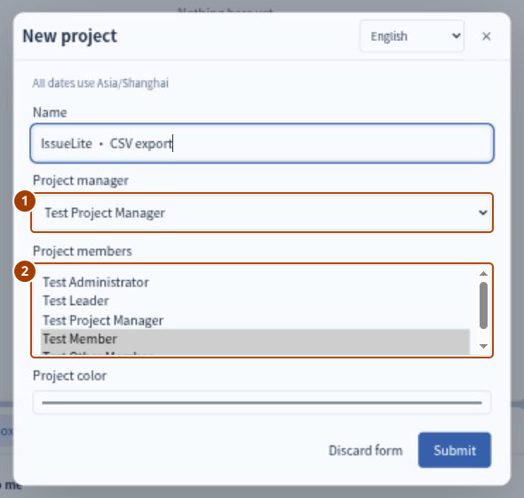

**检查结果：** 左侧任务树出现新项目。成员列表用于组织协作；任务提交后仍然对全团队可见。

## 2. 写清任务要求并提交审批

切换到 `member`，点击 **New task（新建任务）**，为任务 **C** 填写以下内容：

| 字段 | 复制或选择 |
| --- | --- |
| Title（标题） | `Implement CSV export` |
| Project（项目） | `IssueLite · CSV export` |
| Owner（负责人） | Test Member |
| Reviewer（验收人） | Test Project Manager，此项目与负责人的默认值 |
| Expected result（预期结果） | Synthetic walkthrough: export the filtered issue list as CSV, with implementation and self-test notes. |
| Scope（范围） | Number, title and status. No import, attachments or permission changes. |
| Acceptance criteria（验收标准） | Preserve filters; readable international text; escape commas, quotes and line breaks; keep headers for empty results. |

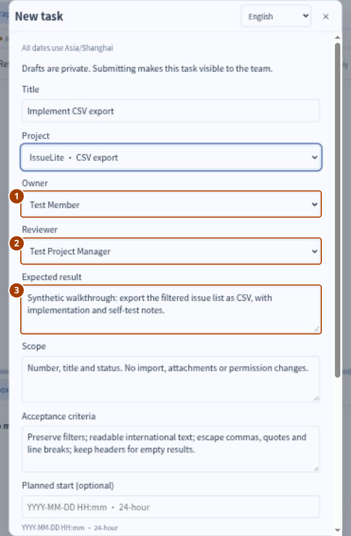

这里约定的是：导出筛选后的编号、标题、状态三列，国际文字可读，特殊字符正确转义，空结果保留表头。**① 负责人** 接受并执行，**② 验收人** 检查成果是否满足 **③ 预期结果** 和验收标准。创建者可以是另外一个人。

向下滚动填写日期。请按你跟做的当天选择 **未来日期**，使用 **上海时区**，格式为 `YYYY-MM-DD HH:mm`。截图中的安排如下：

| 字段 | 截图中的值 | 含义 |
| --- | --- | --- |
| Planned start（计划开始） | 2026-10-14 09:00 | 可选的计划起点 |
| Accept by（接收期限） | 2026-10-14 10:00 | 负责人应在何时回应 |
| Next feedback（下次反馈） | 2026-10-14 16:00 | 下次正式汇报进展的时间 |
| Delivery deadline（交付期限） | 2026-10-16 18:00 | 何时应拿出交付结果 |

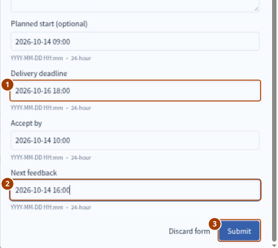

点击 **③ Submit（提交）**。**检查结果：** 任务为 **Draft（草稿）**，只有创建者可见。这个按钮只是保存表单，还没有下发任务。打开 C，再点 **Submit for approval → Submit（提交审核 → 提交）**，任务才对团队可见并开始审批。

## 3. 完成两级创建审批

用 `manager` 打开 C。先练习一次纠正：点击 **Return for editing（退回修改）**，原因填 `Please make the empty-result behavior explicit before approval.`，即“请先明确空结果的表现”。

切换到 `member`，打开 C，点 **Edit draft（修改草稿）**，将最后一条标准改成 `An empty result contains the three column headers and no data rows.`，明确空结果只有三列表头。保存后，再次 **Submit for approval（提交审核）**。

用 `manager` 执行 **Approve creation → Submit（通过创建审核 → 提交）**。此时仍是 **① Creation approval（待创建审核）**，**② Waiting for（等待处理人）** 变为 **Test Leader**。

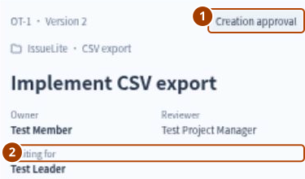

切换到 `leader`，打开 C 并 **Approve creation（通过创建审核）**。**检查结果：** 变为 **Awaiting acceptance（待接收）**，等待 Test Member。“批准可以做”之后，还需要执行方明确接受。

项目负责人自己创建本项目任务时直接交给团队负责人；团队负责人自己的草稿可以直接下发。`admin` 只有账号管理权限，不会自动获得业务审批权限。

## 4. 创建父子任务并设置前置依赖

用 `leader` 创建 A、B、D，采用同样的未来时间安排和下表分工。每个表单保存后仍是草稿，还需 **Issue task（下发任务）**。

| 简称 | 标题 | 负责人 → 验收人 | 预期结果与验收标准 |
| --- | --- | --- | --- |
| A | Deliver CSV export v0.1 | manager → leader | 交付汇总，引用已验收的规则、实现和验证结果 |
| B | Confirm export rules | manager → leader | 明确三列字段、筛选范围、编码、转义和空结果行为 |
| C | Implement CSV export | member → manager | 已在第 2–3 步创建 |
| D | Verify and prepare delivery notes | other → manager | 说明覆盖筛选、国际文字、逗号、双引号、换行、空结果六类情况 |

分别打开 B、C、D，在 **Task content → Connections & delivery → Relations → Add relation（任务内容 → 关联与交付 → 关系 → 添加关系）** 里，将 A 设为 **Primary parent（主归属）** 并说明贡献。然后在 C 中将 B 设为 **Prerequisite（前置依赖）**，在 D 中将 C 设为前置依赖。

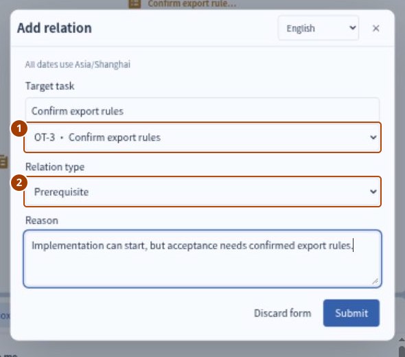

**① Target task（目标任务）** 选择提供所需成果的前置任务。**② Prerequisite** 意味着它必须先验收完成，本任务才能验收通过，但不会阻止本任务提前开始。


教程图表示 **成果验收顺序**。应用图谱中的依赖箭头则从后置任务指向它需要的前置任务。父子关系回答“这个目标由哪些工作组成”，前置依赖回答“验收之前需要哪个结果”。

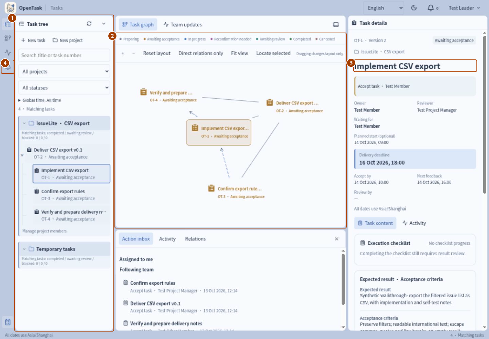

从 **① 任务树** 找工作，用 **② 图谱** 看关系，在 **③ 详情** 阅读同一条任务，**④ Action inbox（待处理事项）** 告诉每个人现在需要回应什么。点击图谱节点和树中的任务行会打开同一记录；拖动图谱节点只改变布局。

## 5. 接收任务并申请执行清单

用 `member` 打开 C，执行 **Accept task → Submit（接收任务 → 提交）**，状态变为 **Accepted（已接收）**；再 **Start work → Submit（开始执行 → 提交）**，变为 **In progress（进行中）**。如果这两个决定同时发生，也可直接用 **Accept and start（接收并开始）**。

点击 **Request checklist edit（申请修改清单；较早截图中为 Request checklist change）**，每行填写一项：

```text
Export currently filtered results
Document encoding and CSV escaping
Cover empty results and six verification cases
```

这三项分别是筛选导出、编码与转义、空结果与六类验证。原因填 `Break the agreed result into visible execution steps.`，不要勾选 **Changes scope or acceptance criteria（改变范围或验收标准）**。

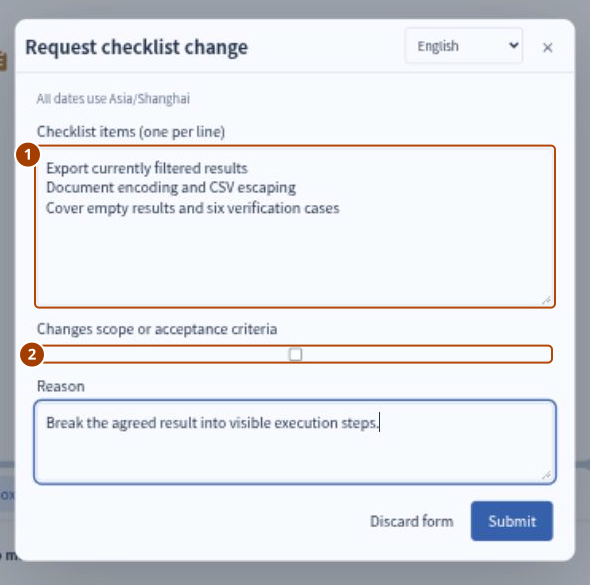

**① 此时提交的是提议**，清单尚未生效。**② 不勾选** 表示只是分解已约定的工作。用 `leader` 打开 C，**Approve checklist（确认清单变更）**。再用 `member` 刷新，应看到三项尚未完成的清单。

## 6. 报告阻塞并请求协助

用 `member` 点击 **Report blocker（报告阻塞）**：

- Reason（原因）：`The empty-result header behavior needs confirmation.`
- Help needed（所需协助）：`Confirm whether an empty export keeps all three column headers.`
- Helper（协助人）：**Test Project Manager**。

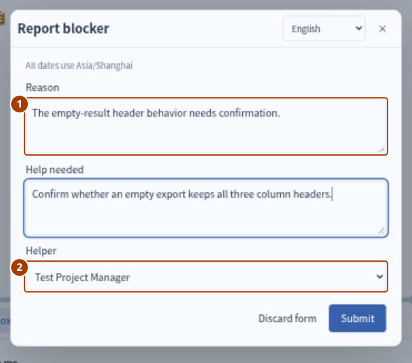

**① 说清需要确认的决定，② 指定一个能回应的人。** 用 `manager` 打开 C，进入 **Connections & delivery → Blockers → Reply to blocker（关联与交付 → 阻塞 → 回复协助）**，答复 `Keep number, title and status as headers, with no data rows.`，即“保留三列表头，没有数据行”。

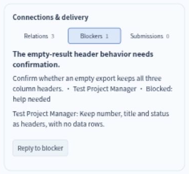

用 `member` 执行 **Resolve blocker（解除阻塞）**，说明 `The header behavior is now clear; continuing the implementation notes.`。**检查结果：** 阻塞和回复仍可查看。报告或解除阻塞都不会自动改交付期限，也不代替正式进展。

## 7. 调整任务要求并确认新版本

用 `member` 执行 **Request agreement change（申请调整约定）**：`Specify UTF-8 BOM so exported international text opens correctly in Excel.`，请求明确 Excel 打开文件时的编码要求。

用 `leader` 打开 **Adjust agreement（调整约定）**，在验收标准中加上 `Include UTF-8 BOM for Excel`，填写未来的 **① Confirm adjustment by（调整确认期限）** 和 **② 变更原因**，然后提交。

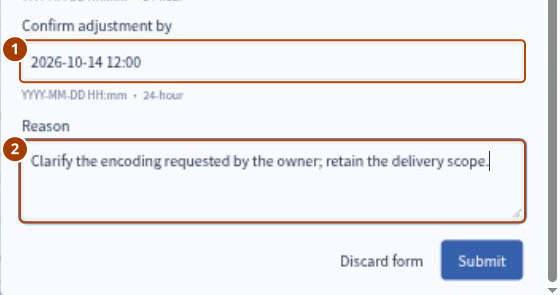

用 `member` 打开 C，在 **Confirm this version → Agreement changes（确认当前版本 → 约定变更）** 中比较前后约定。版本号已经增加；确认之前，此前已接收的任务约定仍可查看。

先试一次未确认就 **Submit result（提交成果）**：填写简短成果和未来的 **Review by（验收期限）** 后提交。系统会保留表单，并提示：

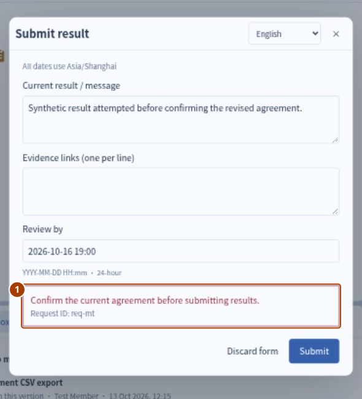

用 **Discard form（关闭表单）** 退出，再 **Confirm this version → Submit（确认当前版本 → 提交）**。**检查结果：** 版本确认待办消失。约定变更会留下新版本；勾选清单本身不会改变约定版本。

## 8. 汇报进展，并保存清单完成情况

用 `member` 点击 **Record progress（提交正式进展）**：

| 字段 | 示例 |
| --- | --- |
| Current result / message（当前结果） | Synthetic progress: filtered export and encoding notes are ready. |
| Next step（下一步） | Add escaping and empty-result verification notes, then request review. |
| Next feedback（下次反馈） | 未来时间，本次使用 2026-10-15 14:00 |

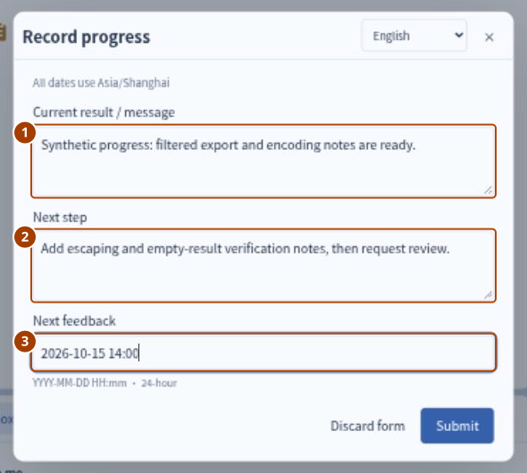

三项信息一起回答：现在已有了什么、接着做什么、什么时候再有消息。讨论可以用 **Add comment（发表评论）**，但评论不算正式反馈，也不会推迟反馈期限。

勾选三项清单，再点击 **Save checked progress（保存勾选进度；较早截图中为 Confirm submission）**；未提交的勾选只是本地编辑。刷新后看保存结果：

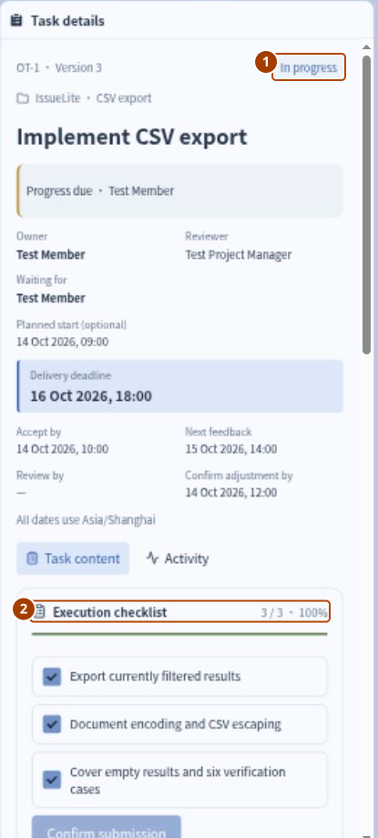

**① In progress（进行中）与 ② 3/3、100% 同时出现是正确的。** 清单说明执行到了哪里，验收人还需要检查真正提交的成果。

## 9. 提交成果与验收期限

用 `member` 执行 **Submit result（提交成果）**，填写：

```text
Synthetic result v1: filtered export and UTF-8 BOM are documented.
Special-character evidence is still missing.
```

这里故意说明第一版还缺特殊字符验证。填写未来的 **Review by（验收期限）**。证据链接可选，有相关材料时填写 HTTP(S) 链接；本练习可以留空。

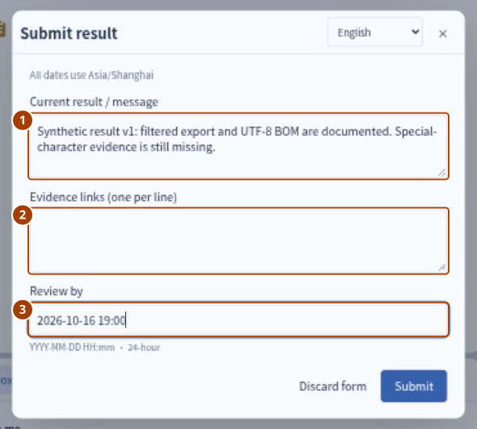

**① 说明交付了什么，② 有真实证据就附链接，③ 约定何时验收。** OpenTask 保存文字和 HTTP(S) 链接，不上传文件，也不验证链接内容。**检查结果：** 任务变成 **Awaiting review（待验收）**，等待 Test Project Manager。

## 10. 检查前置依赖并退回不完整成果

先保持 B 未完成。用 `manager` 对 C 执行 **Accept result → Submit（验收通过 → 提交）**。

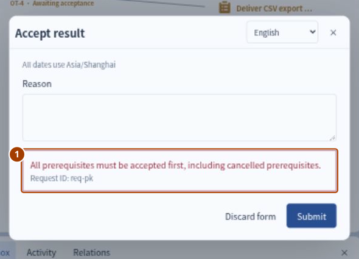

**检查结果：** 操作被拒绝，C 仍为 **Awaiting review（待验收）**。关闭表单，改用 **Return result（验收退回）**，原因填 `Add verification notes for commas, double quotes, line breaks and empty results.`，并设定未来的 **Next feedback（下次反馈）** 时间。

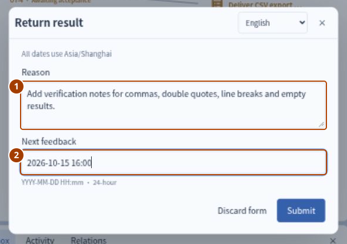

提交后 C 回到 **In progress（进行中）**。退回把“还不行”变成了具体的下一步，并在同一任务中保留第一版成果和验收意见。

## 11. 完成前置任务并重新提交成果

用 `manager` 打开 B，**Accept and start（接收并开始）**，再 **Submit result（提交成果）**，说明字段、筛选、UTF-8 BOM、转义和空结果规则。用 `leader` 对 B 执行 **Accept result（验收通过）**。

用 `member` 再次提交 C：

```text
Synthetic result v2: notes now cover filters, international text,
commas, double quotes, line breaks and empty results.
This is an OpenTask workflow rehearsal, not a shipped IssueLite feature.
```

这次补齐六类说明，并注明是 OpenTask 流程演练。填写未来的验收期限，再由 `manager` 验收通过。在 **Connections & delivery → Submissions（关联与交付 → 成果提交）** 中，两次结论都还在：

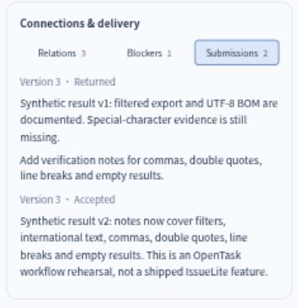

**检查结果：** C 为 **Completed（已完成）**。一条成果是 **Returned（已退回）**，另一条是 **Accepted（已接收）**。同一个约定版本下，也可以有多次独立提交。

## 12. 汇总子任务成果并验收父任务

用 `other` **Accept and start（接收并开始）** D，提交标明模拟的六类验证和交付说明；用 `manager` 验收通过。

这时 B、C、D 都完成了，**A 并没有自动完成**。用 `manager` 接收并开始 A，提交引用三个已验收子任务的交付汇总；再由 `leader` 验收。

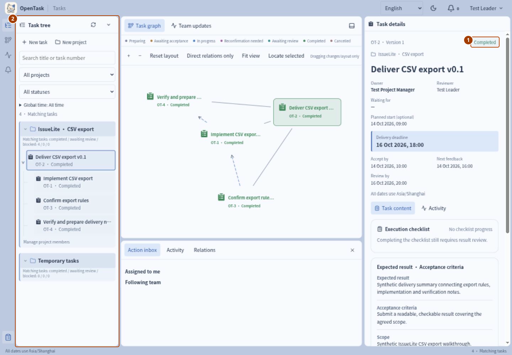

**① 父任务有自己的验收，② 四个任务现在都显示 Completed（已完成）。** 用链接重新打开 C，再刷新，版本、成果和关系仍在。已完成任务不能重开，后续修复应另建关联任务。

## 13. 调整并取消后续任务

团队接着提出 CSV 导入。在同一个项目里创建 **E：Explore CSV import follow-up**，负责人为 `member`，验收人为 `manager`。预期结果是 **可行性建议**，还不是实现。下发后，将 C 添加为 **Related task（普通关联）**，只记录背景，不设验收依赖。

跟做下面这段规划过程：

1. `member` 用 **Unable to accept（无法接收）** 说明时间冲突。E 仍为待接收，下发人需要回应。
2. `leader` **Adjust agreement（调整约定）**，将负责人换成 Test Other Member，解释原因；`other` **Accept and start（接收并开始）**。换人后要重新接受工作。
3. `other` 申请清单 `Build a complete CSV import engine`。`leader` 用 **Reject checklist（退回清单变更）** 说明当前只约定了可行性建议。申请留在记录里，现行清单不受影响。
4. `other` 重新申请 `Compare import options` 和 `Document permission and validation risks`，勾选 **Changes scope or acceptance criteria（改变范围或验收标准）**，增加风险评估范围。`leader` 批准并设确认期限，`other` 确认新版本。
5. `other` 申请把本周实现也纳入任务。`leader` 用 **Close adjustment request with response（回复并结束调整申请）** 解释实现需要另行决定。关闭申请本身不会改约定。
6. `other` 提交建议等待验收；`leader` 调整标准，增加工作量估算要求。E 回到 **In progress（进行中）**，原待验收成果变为 **Superseded（已被新版本取代）**。如果继续，需要确认新约定并重交成果。
7. `leader` 用 **Title（标题）** 改名为 `Assess CSV import for a later release`，然后 **Cancel task（取消任务）**，说明团队已决定延期考虑导入。E 变为 **Cancelled（已取消）**，相关决定和与 C 的联系保留下来。

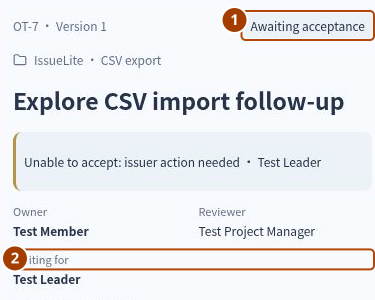

图中是下发人的视图：**① Awaiting acceptance（待接收）** 表示负责人尚未接收任务，**② Waiting for（等待处理人）** 显示团队负责人。切换到下发人的待办处理这次拒绝。

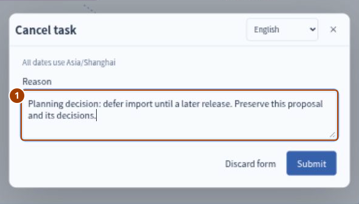

这个分支展示了计划如何被修正并留下记录。取消会结束任务，但不会擦掉讨论，也不等于一个前置成果已经完成。

## 14. 继续练习搜索、筛选和查看动态

继续在[使用指南](USER-GUIDE.md)里操作这个项目：按标题或编号找 C，按时间筛选已完成工作，查看动态，调整项目颜色，使用手机界面，了解账号管理。再建一条不填日期的私有草稿 `Collect feedback for the next iteration`，放在 **Temporary tasks（临时任务）** 里，体验尚未准备好归入项目的工作。

其他功能的说明见[功能与操作入口](FEATURES.md)。

## 查看任务中保留的记录

打开 C 的动态和成果记录，可以查看负责人何时接收任务、任务要求怎样改变、请求过哪些协助、第一版成果为何被退回，以及第二版由谁验收通过。

本案例不包含真实 CSV 功能的开发或发布。若要检查 OpenTask 候选版本，按[发布检查](RELEASE-CHECK.md)操作；此前的结果保留在[历史验收记录](RELEASE-CASE-RESULT.md)中。
