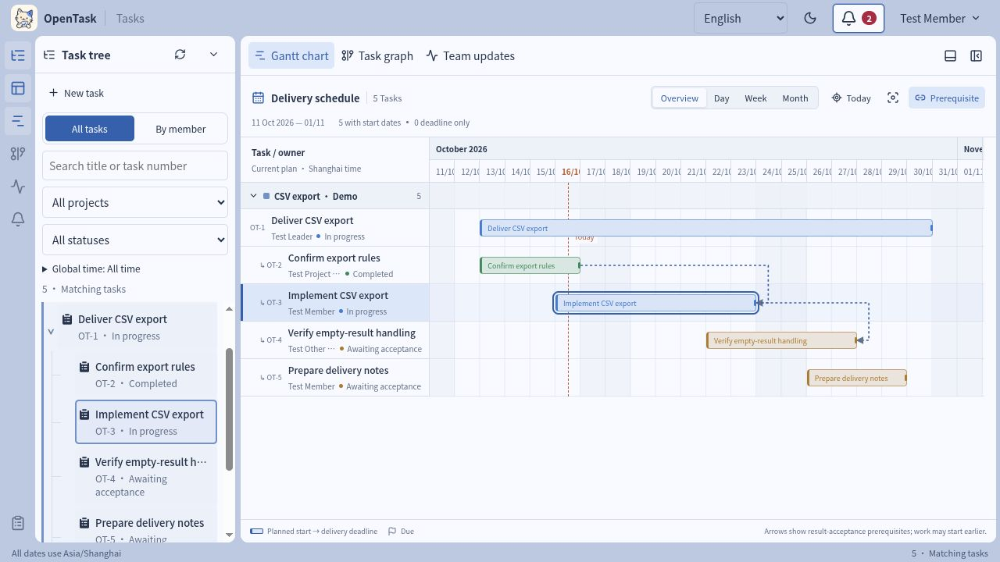
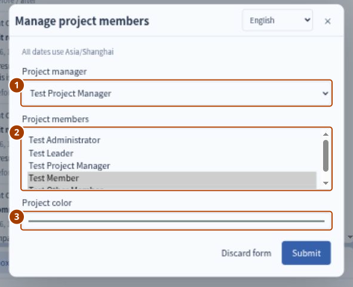

# OpenTask 日常协作 Q&A

[English](../en/FAQ.md)

本手册面向普通成员、项目负责人和团队负责人，回答权限、任务创建、执行清单、正式进展、交付验收和时间安排中的常见问题。适用于当前单团队 alpha 版本；日期统一使用上海时间。

日常使用时，先确认任务的负责人、验收人、状态和等待处理人，再选择操作。**清单勾完、报告进展、提交成果和验收通过是不同动作；只有验收通过才表示任务完成。**

工作区配图拍摄于 2026-10-16，其余配图沿用 10 月 13 日的英文界面演练截图，用于定位入口与字段；图中的任务和日期均为模拟数据。当前控件说明以已合并的 `mvp` 为准，版本范围与新图来源见[更新记录](RELEASE-NOTES.md)，较早截图的来源见[截图与检查记录](SCREENSHOTS.md)。首次跟做可先阅读[完成第一条任务](FIRST-TASK.md)。

## 一 界面入口

### Q1 日常应该从哪里开始

打开顶部铃铛或侧栏的 **Action inbox（待处理事项）**，查看 **Assigned to me（待我处理）**。点击待办进入任务，再看详情顶部的 **Status（状态）、Owner（负责人）、Reviewer（验收人）、Waiting for（等待处理人）**。团队负责人还可以通过 **Following team（团队跟进）** 跟进全队待办。

桌面左侧是任务树，中间工作区默认打开甘特图，也可在页签中选择 **Task graph（任务图谱）**。在任务树、甘特图或图谱中选中任务后，打开详情，再在面板内部向下滚动查找内容和操作按钮。手机端先切到 **Task details（任务详情）**。

[](../assets/updates/2026-10-16/workspace-current-en.jpg)

### Q2 为什么我看不到别人提到的操作按钮

按钮随身份和阶段变化，不是每个人都能操作每条任务。例如，提交正式进展只对任务负责人开放，验收按钮只对指定验收人开放。

依次检查：当前登录账号是否正确；自己是不是本任务负责人或验收人；任务处于哪个阶段；是否已在详情面板内部向下滚动。若任务或约定刚被他人修改，刷新后重新阅读再操作。刷新不会保存尚未提交的表单或清单勾选。

## 二 账号角色与项目职责

### Q3 member 能创建项目吗

不能。只有拥有 **leader（团队负责人）** 账号角色的用户能创建项目。项目负责人身份或单独的 admin 角色都不会自动获得这项权限。

由团队负责人在左侧任务树上方点击 **New project（新建项目）**，填写项目名称，指定项目负责人、成员和颜色，再提交。普通成员不会看到新建项目按钮，直接调用接口也无权创建。

### Q4 manager 是全局角色还是项目职责

**manager 是具体项目的负责人职责，不是全局账号角色。** 账号角色只有 admin、leader 和 member；每个项目单独指定一位负责人。

同一个人可以负责 A 项目，同时作为普通成员参与 B 项目，也可以负责多个项目。项目负责人可以维护本项目的成员和颜色、参与本项目任务的创建审批；只有被指定为某条任务的验收人，才能验收那条任务。演示账号名 `manager` 不代表系统存在同名全局角色。

### Q5 task 已创建后，还能把 member 指定为项目负责人吗

可以，由团队负责人操作。展开对应项目，点击 **Manage project members（管理项目成员）**，在 **Project manager（项目负责人）** 中选择启用状态的目标账号，然后提交。每个项目只有一位负责人，因此这是替换原负责人。



已有任务不一定阻止更换，但以下任一情况会阻止：

- 本项目存在正在创建审批中的任务。
- 原项目负责人仍担任本项目非草稿、未结束任务的负责人或验收人。

先处理审批，或由团队负责人通过任务的 **Adjust agreement（调整约定）** 移交相关职责，再更换项目负责人。更换不会自动修改已有任务的负责人、验收人或历史记录。若只是让某人负责一条任务，应修改该任务负责人，而不是更换项目负责人。

### Q6 member 可以看到团队其他人的进展吗

可以。已提交的任务对全团队可见，包括任务内容、清单、正式进展、成果和动态，不要求查看者在该项目成员列表里。

他人的私有草稿不可见；任务提交审批后，即使后来被退回修改，仍对团队可见。项目成员列表用于组织协作，不提供数据隔离。可以查看不代表可以代替负责人更新进展，或代替验收人验收。

### Q7 怎样查看某个人或某条任务的历史

查看单条任务时打开 **Activity（动态）**；查看团队变化时打开 **Team updates（团队更新）**，按 **Author（作者）** 筛选，有 **Load more（加载更多）** 时可读取更早记录。

要查某个人的职责，用 **By member（按成员）** 选择 **Related member（相关成员）**，组合负责、创建／下发、审批／验收范围。作者筛选查“谁进行了操作”，[成员筛选](USER-GUIDE.md#按成员关系筛选任务)查“谁与任务有职责关系”。

分享任务时复制带 `?task=<UUID>` 的任务 URL。其他团队账号打开链接后仍需满足原有可见性规则，链接不会公开私有草稿。团队更新受当前任务筛选条件影响，单条任务的动态保留完整历史。

## 三 从创建到接收

### Q8 为什么新建任务后一直是草稿

**New task（新建任务）** 表单的 **Submit（提交）** 只是保存私有草稿，不等于送审或下发。草稿可以暂不填写日期，也可以选择 **Temporary tasks（临时任务）**，暂不归入项目。

写清预期结果、验收标准、负责人、验收人、接收期限、交付期限和下次反馈时间后，普通成员点击 **Submit for approval（提交审核）**。团队负责人可以对自己的草稿使用 **Issue task（下发任务）**。审批完成或直接下发后，任务进入待接收，仍需负责人接受。

### Q9 创建审批通过和负责人接收有什么区别

审批表示“这项工作可以开展”，接收表示“指定执行者同意承担”。两者是不同决定。

普通成员创建项目内任务时，通常先由项目负责人审批，再由团队负责人最终审批。项目负责人创建本项目任务时直接交给团队负责人；两者为同一人时只有一级。临时任务交由团队负责人审批。

到达 **Awaiting acceptance（待接收）** 后，负责人可点击 **Accept task（接收任务）**，随后 **Start work（开始执行）**；也可直接选择 **Accept and start（接收并开始）**。

### Q10 任务安排不合适或无法按时接收怎么办

待接收时使用 **Unable to accept（无法接收）**，写明时间、范围或资源上的原因。任务仍为待接收，由下发人处理，不会自动取消或转交他人。

已经接收后需要改范围、人员或期限，参与者可以用 **Request agreement change（申请调整约定）** 提出原因；由团队负责人决定是否调整。仅发表评论或报告阻塞不会改变约定。

## 四 执行清单与正文格式

### Q11 执行清单应该怎么写

一项写一个具体动作，并给出能判断完成的依据。清单回答“怎样推进”；验收标准回答“做到什么才算交付合格”。避免只有“开发”“测试”“持续优化”这类笼统标题。

以“导出当前筛选结果为 CSV”为例，可在清单申请中填写：

```text
确认导出列、排列顺序和空值规则
实现按当前筛选条件生成 CSV
验证中文、逗号、引号和换行的导出结果
验证空结果时仍保留约定的表头
整理测试结果和使用说明，供成果提交时引用
```

独立负责人、独立期限或需要单独验收的工作，更适合拆成子任务。不要在清单中悄悄加入未约定的新需求。

### Q12 如何申请清单，批准后怎样保存勾选

由任务负责人在详情的执行清单区域点击 **Request checklist edit（申请修改清单）**；较早配图中叫 **Request checklist change**：

1. 在 **Checklist items (one per line)（清单内容，每行一项）** 输入条目，每行直接写内容，无需加 `- [ ]`。
2. 不改变约定时，原因可选；若改变原约定范围或验收标准，勾选 **Changes scope or acceptance criteria（改变范围或验收标准）** 并填写原因。
3. 提交后等待团队负责人 **Approve checklist（确认清单变更）** 或 **Reject checklist（退回清单变更）**。批准前，现行清单不变。
4. 批准后，负责人勾选完成项，再点击 **Save checked progress（保存勾选进度）**。刷新前核对成功提示与已保存数量；**Undo unsaved checks（撤销未保存勾选）** 只丢弃未保存标记。较早配图中的保存按钮叫 **Confirm submission**。

再次申请时，表单带入现行条目，应保留仍需要的条目并修改整份拟议清单。涉及范围变化的批准会产生新约定版本，需要负责人确认。


### Q13 清单完成 100% 后，任务为什么还没完成

清单统计的是执行步骤，不能代替成果提交和验收。负责人仍需点击 **Submit result（提交成果）**，验收人确认达到标准后点击 **Accept result（验收通过）**，任务才完成。项目和图谱中的任务数量也不是成果验收的完成百分比。

### Q14 Markdown 怎样插入超链接，所有字段都支持吗

在支持 Markdown 的任务正文、正式进展等区域，使用：

```markdown
已完成编码检查，详见[测试报告](https://example.com/report)。
下一步按[接口文档](https://example.com/api)补充边界用例。
```

格式为 `[显示文字](链接地址)`。将示例网址替换为团队实际可访问的资料地址；OpenTask 不会自动授予外部资料的访问权限。

预期结果、验收标准和范围的编辑器也提供 **Bold、List、Link（加粗、列表、链接）** 及 **Edit / Preview（编辑／预览）**。提交前可预览正文；预览中的复选框不会改变执行进度。

**执行清单条目目前按普通文本显示**，不要依赖条目中的 Markdown 链接或 `- [ ]` 生成可点击链接和复选框。可将相关链接放在预期结果、正式进展或成果说明中。提交成果表单的 **Evidence links（证据链接）** 则每行直接填一个 HTTP(S) 地址，不写 Markdown 包装。

## 五 正式进展与成果交付

### Q15 更新进度和交付有什么区别

| 对比 | 提交正式进展 Record progress | 提交成果 Submit result |
| --- | --- | --- |
| 目的 | 说明现在做到哪、下一步做什么 | 提交交付物，请验收人判断是否达到标准 |
| 操作人 | 任务负责人 | 任务负责人 |
| 可用阶段 | 已接收或进行中 | 进行中，且已确认当前约定版本 |
| 表单内容 | 当前结果／说明、下一步、下次反馈 | 成果说明、可选证据链接、验收期限 |
| 提交后 | 保持原任务阶段，更新反馈安排 | 进入待验收，等待指定验收人 |

“已完成导出实现，正在检查中文编码，明天下午反馈测试结果”是进展；“约定功能和测试已完成，以下是成果与测试报告，请验收”是交付。

### Q16 如何提交正式进展，内容写到什么程度

任务负责人打开已接收或进行中的任务，在详情下方点击 **Record progress（提交正式进展）**，填写三项内容，再点击 **Submit（提交）**：

| 字段 | 示例 |
| --- | --- |
| Current result / message 当前结果／说明 | 已实现按当前筛选条件导出，中文、逗号和引号用例已通过；空结果用例尚待确认。 |
| Next step 下一步 | 与项目负责人确认空结果表头规则，补齐用例并整理测试报告。 |
| Next feedback 下次反馈 | 填写下一次能给出明确进展的未来时间，例如 `2026-10-16 15:00`。 |

进展应包含已经得到的结果和剩余问题，不只写“处理中”。若示例日期已过，请改成实际未来时间。提交不会自动把“已接收”改为“进行中”，开始工作仍需对应操作。


### Q17 每次提交正式进展会覆盖前一次吗

**详情显示最新一次，历史逐次追加保留。** 详情中的最近进展区域更新为本次的当前结果、下一步和提交时间；任务的下次反馈时间也会更新。

之前的内容仍可在 **Activity（动态）** 查看，团队更新也会记录本次操作。因此无需把之前全部进展复制到新记录中。想回看过程用动态，想快速了解现状看最近进展。

### Q18 发表评论、勾清单或报告阻塞能代替正式进展吗

不能。评论用于讨论，清单记录步骤完成，阻塞请求用于明确所需协助；这些操作都不会代替正式进展，也不会自动推迟下次反馈或交付期限。

遇到阻塞时，用 **Report blocker（报告阻塞）** 写明原因、所需帮助和协助人；协助人在 **Connections & delivery → Blockers（关联与交付 → 阻塞）** 回复，负责人在问题解决后 **Resolve blocker（解除阻塞）**。需要改期限时另行申请调整约定。

### Q19 如何交付、验收和返工

1. 负责人确认任务处于进行中，且已确认当前约定版本。
2. 在详情下方点击 **Submit result（提交成果）**，填写成果说明、可选证据链接（每行一个 HTTP(S) 地址）和验收期限，再提交。当前版本以链接提供证据，不支持直接上传文件。
3. 任务进入 **Awaiting review（待验收）**。验收人在 **Connections & delivery → Submissions（关联与交付 → 成果提交）** 阅读成果，对照验收标准判断。
4. 验收人点击 **Accept result（验收通过）** 后任务完成；或点击 **Return result（验收退回）**，写明缺口和下次反馈时间，任务回到进行中。
5. 负责人补充后重新提交，旧成果和退回理由保留，不必为同一轮返工另建任务。


验收人不是自动等于创建者或项目负责人，应以详情中的 **Reviewer（验收人）** 为准。普通成员负责项目任务时默认由项目负责人验收，项目负责人负责时默认由团队负责人验收，也可指定其他有效验收人。只有团队负责人可以验收自己的任务。

## 六 时间节点与约定变更

### Q20 当前有哪些重要时间节点

| 界面字段 | 含义 | 何时填写或更新 |
| --- | --- | --- |
| Planned start 计划开始，可选 | 预计开始执行的时间 | 创建或调整约定时填写，不能晚于交付期限 |
| Accept by 接收期限 | 负责人最晚明确接收任务的时间 | 提交审批或下发前填写 |
| Next feedback 下次反馈 | 最晚再次报告进展的时间 | 提交审批或下发前填写，之后随正式进展更新；验收退回时也会重新安排 |
| Delivery deadline 交付期限 | 任务约定的交付截止时间 | 提交审批或下发前填写，需变更时调整约定 |
| Review by 验收期限 | 验收人最晚判断本次成果的时间 | 提交成果时填写 |
| Confirm adjustment by 调整确认期限 | 负责人最晚确认新约定版本的时间 | 调整约定或批准涉及范围变化的清单时填写 |

计划开始不会自动启动任务。创建、修改、进展提交、成果提交和验收等实际发生时间由系统记录，无需手填。

### Q21 下次反馈时间怎么选，格式是什么

填写一个能兑现的未来时间，表示“最晚何时再次说明进展”，不一定是工作完成时间。应根据下一步工作的规模和风险安排；没有最终结果时，也可以反馈已确认的情况、阻塞和下一步。

日期时间输入统一使用上海时间（UTC+8）、24 小时制，格式为 `YYYY-MM-DD HH:mm`。可手输，也可点字段旁的 **Choose date（选择日期）**；时间筛选中只含日期的范围使用 `YYYY-MM-DD`。

```text
2026-10-16 15:00
```

日期和时间之间留一个空格；月、日、小时和分钟写两位；不填秒和时区，不直接填“明天下午”。采用示例时改成实际未来日期。日期输入和成果证据链接都应使用字段规定的格式，而不是 Markdown。

### Q22 到了期限系统会自动改变任务状态吗

不会因为计划开始或期限到达而自动开始、接收、完成或取消任务。接收、反馈、验收、约定确认和交付超期时，系统会在适用阶段产生逾期待办，仍由相应人员处理。后台 worker 需要保持运行，才能持续刷新时间触发的提醒。

**提交成果不等于已经完成交付流程。** 待验收阶段超过交付期限，仍可能出现交付逾期，并交给验收人处理；不能仅凭已有成果提交就判断任务不会逾期。提醒异常见[启动问题排查](QUICKSTART.md#常见启动问题)。

### Q23 需求、负责人或期限变化后应该怎样处理

非团队负责人的参与者使用 **Request agreement change（申请调整约定）**，说明要改什么和原因。团队负责人通过 **Adjust agreement（调整约定）** 修改约定，填写变更原因与调整确认期限；也可以回应并关闭申请而不改变约定。

负责人在 **Agreement changes（约定变更）** 阅读前后差异，再点击 **Confirm this version（确认当前版本）**。未确认当前版本时不能提交成果。更换任务负责人后，由新负责人重新接收；待验收时调整约定，原待验收成果会保留为 **Superseded（已被替代）**，任务回到进行中，需按新约定继续处理。

## 七 关系与常见异常

### Q24 前置任务或子任务没完成，会影响本任务吗

**前置依赖**要求提供所需成果的前置任务已完成，后置任务的成果才能验收通过；不会自动禁止后置任务提前开始。取消前置任务不代表满足依赖。

**父子关系**用于组织工作。子任务完成不会自动完成父任务；父任务仍需自己的成果和验收。若子任务尚未完成，验收父任务时需说明理由。

从 **Connections & delivery → Relations（关联与交付 → 关系）** 查看关系。普通关联只补充背景，不自动改变状态、日期或验收条件。

### Q25 任务找不到、操作冲突或误填后怎么办

| 现象 | 处理方式 |
| --- | --- |
| 任务在树、甘特图或图谱里消失 | 检查成员、搜索、项目、状态和时间范围；使用任务 URL 定位。筛选不改变任务权限，也不隐藏待办。 |
| 勾选清单后刷新消失 | 勾选后点击 Save checked progress（保存勾选进度），刷新前核对成功提示；未保存改动需要重新填写。 |
| 无法提交成果 | 确认自己是负责人、阶段为进行中，并确认当前约定版本。 |
| 无法验收通过 | 确认自己是验收人，检查前置任务是否完成；父任务还有未完成子项时补充理由。 |
| 提示版本冲突 | 刷新并阅读他人的最新变更，再决定如何重新提交，避免直接覆盖新约定。 |
| 未提交的草稿填错 | 创建者使用 Edit draft（修改草稿）；放弃时使用 Delete draft（删除草稿）。关闭表单不等于删除任务。 |
| 已结束后还有后续工作 | 已完成或已取消任务不能重开；新建关联任务承接后续工作。 |

需要停止未完成任务时，由团队负责人 **Cancel task（取消任务）** 并填写原因。不要用“清单全勾选”或“写一条已完成进展”代替正式结束流程。

## 相关文档

- [使用指南](USER-GUIDE.md)：按功能查入口、权限和状态规则。
- [完成第一条任务](FIRST-TASK.md)：从创建到成果验收的短练习。
- [进阶案例](CASE-CSV-EXPORT.md)：多人审批、清单、阻塞、变更、依赖与返工的完整练习。
- [功能与操作入口](FEATURES.md)：功能索引。
- [API v1](API.md)：接口字段、权限和错误约定。
