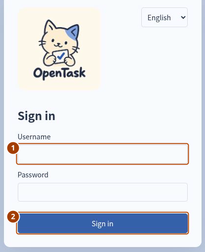

# 本地启动

[English](../en/QUICKSTART.md)

安装后保持两个终端运行，登录后可以[完成第一条任务](FIRST-TASK.md)。已有工作区时，可先[准备独立演练数据库](DEVELOPMENT.md#为教程操作准备独立数据库)，避免混入示例任务。

## 环境

需要 Node.js 24 LTS、npm、Docker Engine 和 Docker Compose。正常应用使用端口 `4310`，PostgreSQL 使用 `55432`；均仅监听本机。

尚未获取源码时，先运行：

```sh
git clone https://github.com/M1racleShih/open-task.git
cd open-task
```

已有源码时直接进入仓库根目录，执行下列命令。初始化不会清空现有任务，重复运行 `npm run db:seed` 也不会重置已有账号的密码。已有工作区请先按[发布检查](RELEASE-CHECK.md)备份。

```sh
npm ci
docker compose up -d --wait db
npm run db:migrate
SEED_PASSWORD='OpenTask-Test-2026!' npm run db:seed
npm run build
npm start
```

另开一个终端，同一目录运行：

```sh
npm run worker
```

打开 <http://127.0.0.1:4310/>。API 与 worker 是两个进程，均需运行；`/health` 只检查 API 与数据库，不代表 worker 正常。

## 演示账号

在新数据库里运行上面的 `npm run db:seed` 会创建以下测试账号，初始密码统一为 `OpenTask-Test-2026!`。

| 用户名  | 显示名称             | 主要用途                           |
| ------- | -------------------- | ---------------------------------------- |
| leader  | Test Leader          | 建项目、最终创建审批、批准清单与调整约定 |
| manager | Test Project Manager | 创建示例项目时指定为项目负责人，也可负责或验收任务   |
| member  | Test Member          | 普通成员，可负责和验收任务                           |
| other   | Test Other Member    | 另一普通成员账号，用于多人协作练习     |
| admin   | Test Administrator   | 管理账号；不会自动获得业务审批权限       |

项目负责人由项目指定，并不是独立的全局账号角色。初始界面为英文；顶部 Language 可切换为简体中文，刷新后仍保留选择。任务正文不会自动翻译。

## 第一次成功登录后看什么



**① Username（账号）** 填 `leader`，密码填 `OpenTask-Test-2026!`，点击 **② Sign in（登录）**。应看到任务树、图谱和等待选择任务的详情区。这个账号应有 **New project（新建项目）** 入口；找不到时，先在 **Account（账户）** 里核对当前账号。

接下来[完成第一条任务](FIRST-TASK.md)，体验创建、接收、进展和验收。

## 停止与重新启动

API 和 worker 的终端按 Ctrl+C；需要停止数据库时运行 `docker compose stop db`。数据库卷为 `open-task-mvp_database`，停止服务不会删除数据。重新运行数据库启动、API、worker 命令即可。`docker compose down -v` 会删除数据库卷，不用于普通停止或案例重跑。

## 常见启动问题

| 现象                                 | 检查                                                                |
| ------------------------------------ | ------------------------------------------------------------------- |
| 登录失败                             | 是否使用正确的数据库与密码；重复运行 `db:seed` 不会重置已有账号密码 |
| 页面可打开，但逾期提醒没有更新       | 是否启动同一数据库上的 worker                                       |
| 新版本访问数据库报错                 | 先执行 `npm run db:migrate` 再启动                                  |
| 地址已被占用                         | 查看哪个进程占用了端口，停止不需要的进程或使用其他空闲端口；保留仍需运行的服务          |

下一步：[完成第一条任务](FIRST-TASK.md)。
