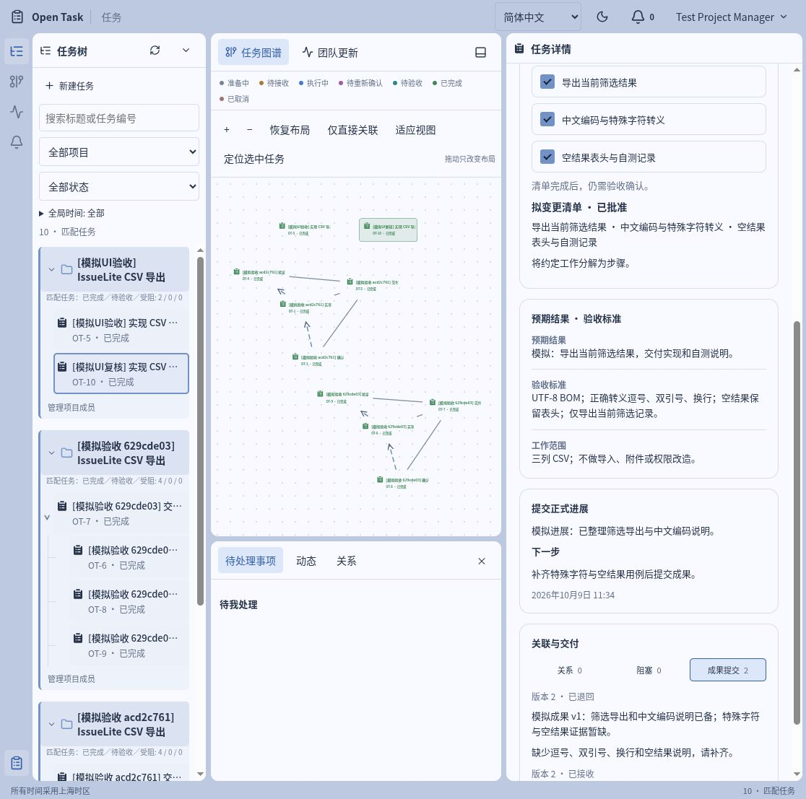

# 模拟开发项目验收报告

[English](../en/RELEASE-CASE-RESULT.md)

验证日期：2026-10-09（上海时区）。候选基于 `c51e608e3faf01e7a7d022699b317b7a11283811` 的工作区，包含本报告验证的案例脚本、使用文档、HTML 生成器与依赖补丁；不是该历史提交自身的验证结果。

本报告记录运行 `629cde03` 及配套界面跟做的历史验收结果。后续候选版本的验证情况见[候选版本检查结果](RELEASE-READINESS.md)，本报告不随测试数量或校验范围的增加而更新。

## 结论

当次候选通过本机单团队 MVP 的功能、数据持久化与依赖检查，可作为本地演示和源码交付的候选版本。四个模拟任务完成了审批、执行、阻塞协作、变更确认和成果验收，并检查了前置依赖限制。成员、项目负责人和团队负责人也在界面完成了成果退回、重新提交和最终验收。

此结论限定在当前本机环境与合成数据。公网部署、生产使用、真实开发效率和持续运行容量不在本次结论中。案例只验证任务协作流程，不包含真实 CSV 功能的开发。

## 验证环境与结果

| 检查             | 结果与证据                                                                                                                |
| ---------------- | ------------------------------------------------------------------------------------------------------------------------- |
| 安装             | Node 24.18.0 / npm 11.8.0；升级依赖后 `npm ci` 成功                                                                           |
| 类型检查         | `npm run typecheck` 退出 0                                                                                                |
| 生产构建         | `npm run build` 退出 0；Vite 8.2.2                                                                                        |
| 单元与数据库回归 | `scripts/test-db.sh`：48 通过、0 失败、0 跳过                                                                             |
| HTTP 案例        | `npm run case:check`：13 组断言通过，run `629cde03`，四任务均为 done                                                      |
| 案例备份恢复     | 同一次案例命令恢复到新数据库，9 张表的行数与内容哈希一致；临时备份及恢复库已清理                                        |
| 浏览器           | 升级依赖后新启动的实例上完成三种角色从创建任务到验收成果的界面操作                         |
| 依赖审计         | 升级依赖后 `npm audit --omit=dev`：0 已知漏洞                                                                                 |
| 新增脚本格式     | 两个 TypeScript 脚本通过 Prettier 检查；两个 Bash 脚本通过 `bash -n`                                                      |
| 文档渲染         | `docs:build` 生成 8 页并验证 24 个本地引用；教程三张截图实际加载，桌面与 390px 视口无页面横向溢出，文档浏览器错误日志为空 |

HTTP API 报告：[本次结果 JSON](../assets/release-case/api-result.json)。完整案例与备份恢复输出：[运行日志](../assets/release-case/api-run.txt)。这些文件只含合成项目、账号显示信息与测试结果，不含会话 cookie 或密码哈希。

## 自动案例覆盖

四任务项目为 `[模拟验收 629cde03] IssueLite CSV 导出`。任务编号仅在该案例数据库有效：A 交付汇总 OT-7、B 导出规则 OT-8、C 实现 OT-6、D 测试交付 OT-9。关系为三个子任务归属 A、C 依赖 B、D 依赖 C。

13 组断言包含：

1. 五个独立 HTTP 会话登录，凭据不进入报告。
2. 普通成员不能建项目，缺少 CSRF 的写入被拒绝。
3. 私有草稿对其他成员不可见；默认验收人正确；幂等重试只产生同一任务。
4. 项目负责人批准后仍等团队负责人；admin 不能代替审批；提交后团队可见。
5. 四任务、三个父子关系、两条依赖持久化。
6. 接受任务，清单申请生成正确待办；批准前不改变现行清单。
7. 调整保留原承诺，旧版本冲突；未确认版本不能交成果，确认后可继续。
8. 报告阻塞、协助人待办、回复与解除；评论不推迟正式反馈。
9. 正式进展保存下一步；清单 100% 不自动完成任务。
10. 非验收人被拒绝，未完成前置阻止验收；退回保留成果与理由。
11. 前置验收后重交通过；旧成果 ID 被拒绝，两次成果记录均保留。
12. 子任务不自动完成父任务；显式验收后四任务完成、无活跃待办；终态不可重开。
13. 操作历史完整；API 重启保留任务及会话；worker 消费停机队列，重启产生新心跳且数据一致。

自动运行器自行启动 API，使用固定 loopback 端口 `4318`，不能重定向到既有工作区。数据库 URL 与实际数据库名双重检查为 `open_task_release_case`。业务场景通过 HTTP 写入；数据库查询用于断言持久化和 worker 行为。

## 界面跟做覆盖

先在独立案例库创建 `[模拟UI验收] IssueLite CSV 导出`，通过真实表单建项目和 OT-5 实现任务。升级依赖后启动 `4321` 新实例，在同一合成项目中重新创建 OT-10 `[模拟UI复核] 实现 CSV 导出`，重新执行：

```text
member 创建草稿 → 提交审核
manager 通过创建审核 → 仍等待 leader
leader 通过创建审核 → 待 member 接收
member 接收并开始 → 申请三项清单
leader 确认清单 → 调整约定
member 确认版本 2 → 正式进展 → 清单 3/3
member 成果 v1 → manager 退回并填下次反馈
member 成果 v2 → manager 验收通过
切换中文 → 刷新 → 已完成，两次成果保留
```

升级依赖后复核的任务链接：[OT-10](http://127.0.0.1:4321/?task=ff691604-bb31-4d92-8ac4-848ab9731367)。仅在此机器的对应案例库与服务运行时可访问；教程不依赖固定 UUID。检查浏览器收集的错误日志返回空列表。

这次 UI 补充跟做主要验证 C 的用户操作路径；B/D/A 从创建到成果验收的流程、阻塞协作、越权和依赖拒绝由自动 API 案例覆盖。没有将这几项 API 证据列为完整 UI 验收。




## 发布检查发现并修复的依赖问题

首次生产审计为 1 高危、3 中危；不是业务流程失败。只更新直接 Fastify 与受影响的间接依赖，保留其他依赖和业务实现。

| 依赖            | 原版本        | 修复版本      | 变更                                               |
| --------------- | ------------- | ------------- | -------------------------------------------------- |
| fastify         | 5.12.3        | 5.12.5        | 直接依赖补丁；HTTP/2 trailer DoS 公告              |
| brace-expansion | 5.0.9         | 5.0.12        | 间接依赖补丁；递归与展开 DoS 公告                  |
| fast-uri        | 3.1.7 / 4.1.4 | 3.1.8 / 4.1.5 | 两条依赖分支分别补丁；URI 归一化与 mailto 解析公告 |
| ip-address      | 10.7.0        | 10.7.1        | 间接依赖补丁；地址族判断与过长输入公告             |

间接依赖使用 `package.json` 中的 overrides，其中 fast-uri 的两个版本系列分别固定；锁文件已更新并经 `npm ci` 验证。后续更新应继续审计，不把固定版本当成永久安全保证。修复后重跑 48 项测试、完整 API 案例、备份恢复和三种角色的浏览器流程检查，均通过。

## 检查范围与发布边界

本次权限、私有草稿、CSRF、版本及成果 ID 检查均经过实际断言。现有回归还覆盖登录、停用账号、退出会话、关系并发、事务回滚、时间偏好和 Markdown 拒绝执行性内容。依赖审计只是当前公告检查，不等同于独立渗透测试。

当前 API 和数据库绑定本机，测试账号用于本地案例。会话 cookie、同源检查及启动方式沿用本机 HTTP 设计。本次不扩展监听范围，不改外部身份或反向代理策略。

案例恢复验证的是合成数据库；升级实际已有工作区前仍需按[发布检查](RELEASE-CHECK.md)验证该工作区的实际备份。本次没有重跑负载测试，没有验证跨机器访问、附件上传、外部通知或真实团队的长期使用。分发方式和许可见[版本说明](RELEASE-NOTES.md)，第三方许可见[第三方声明](THIRD-PARTY-NOTICES.md)。

文档维护源文件是 Markdown，HTML 可通过 `npm run docs:build` 重建。
