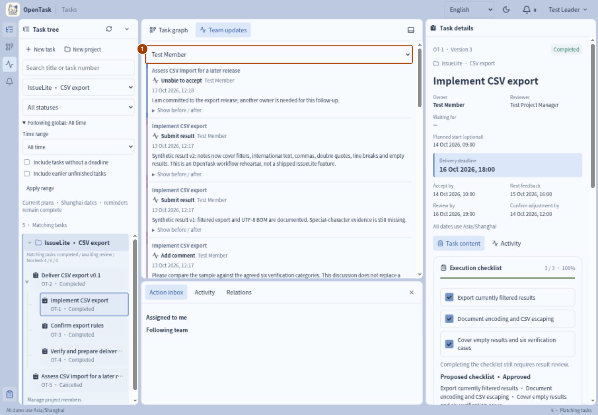
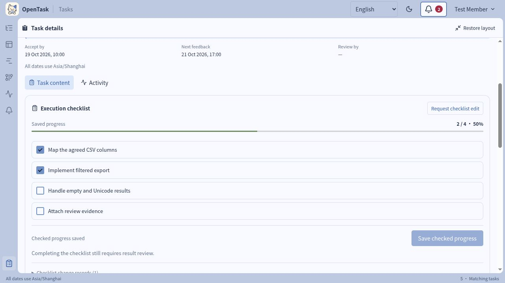
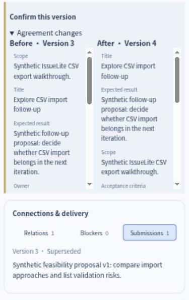
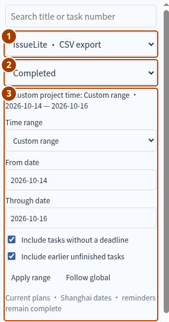
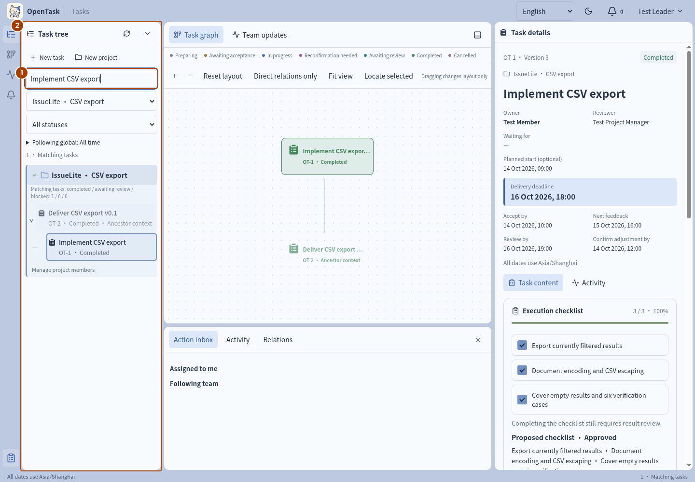
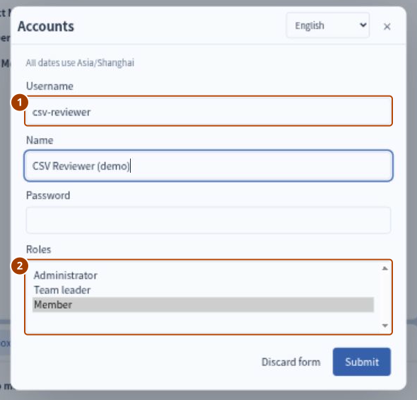
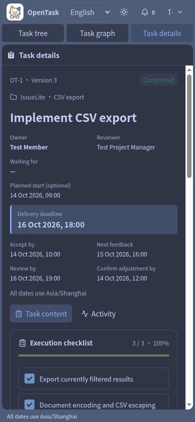

# 使用指南：找到下一步该做什么

[English](../en/USER-GUIDE.md)

第一次使用请先[完成第一条任务](FIRST-TASK.md)。这一页按日常操作说明入口和规则；多人审批、变更和退回的完整练习见[进阶案例](CASE-CSV-EXPORT.md)。下方配图使用英文界面，中文说明保留对应按钮名。

关于角色、清单写法、进展与交付区别、日期格式等常见问题，见[日常协作 Q&A](FAQ.md)。

下方工作区控件说明以最新已合并的 `mvp`（`143e9e7`）为准，已打标签版本的范围见[更新记录](RELEASE-NOTES.md)。较早的教程截图保留原有界面和拍摄日期。

## 查看待办与操作历史

用顶部铃铛或侧栏打开 **Action inbox（待处理事项）**。**Assigned to me（待我处理）** 列出需要你处理的事项；团队负责人还会看到 **Following team（团队跟进）**。点击一项即可打开对应任务。创建审批、接收、清单审批、版本确认、进展、协助回复和成果验收分别分配给相应处理人。日期逾期后会出现逾期待办。

时间筛选不会隐藏待办。图谱里暂时没有任务，不代表没有事情要处理。提醒没有更新时，见[启动问题排查](QUICKSTART.md#常见启动问题)。

想知道某条任务发生了什么，看它的 **Activity（动态）**；想了解整个团队的变化，打开 **Team updates（团队更新）** 并按 **Author（作者）** 筛选。有 **Load more（加载更多）** 时，可继续读取更早记录。

流程操作后，反馈横幅显示对应任务、结果阶段和下一步处理人；带颜色的阶段图标同时保留文字标签。检测到同事改变阶段时，只有读取到对应历史记录才显示操作人和事件时间，不推测缺失信息。可从横幅打开任务动态查看记录；关闭横幅只收起提示，不撤销操作。

动态记录保留操作人、时间、版本、说明和字段变化。成果则在 **Submissions（成果提交）** 中保留 Returned、Accepted、Superseded 等结论，方便分别阅读操作过程与交付物。

## 操作前先读懂这条任务

在任务树、甘特图或图谱中选中任务，先看详情顶部的 **Status（状态）、Owner（负责人）、Reviewer（验收人）、Waiting for（等待处理人）**，再读预期结果、验收标准和日期。**在右侧面板内部向下滚动**，可以找到内容下方的操作按钮；可用按钮取决于账号角色与任务阶段。

**Task content（任务内容）** 包含约定、清单、最近进展，以及 **Connections & delivery（关联与交付）** 下的 **Relations（关系）、Blockers（阻塞）、Submissions（成果提交）**。**Activity（动态）** 保留操作和字段变化。底部面板也提供待办、动态和关系入口。

预期结果、验收标准和范围分区显示 Markdown 内容，较长的范围默认折叠，可按需展开。创建或调整约定时，用 **Edit / Preview（编辑／预览）** 在提交前检查文字；**Bold、List、Link（加粗、列表、链接）** 用来处理选中的文字，编辑器也会显示快捷键。预览里的复选框只供阅读，不会修改执行清单。

复制带 `?task=<UUID>` 的 URL，可以重新打开任务或交给其他团队账号；私有草稿仍受权限限制。刷新读取服务端最新状态，不会替你保存尚未提交的表单或清单勾选。

## 弄清谁有权作决定

| 人员 | 责任 |
| --- | --- |
| 团队负责人 | 建项目、下发任务、最终创建审批、确认清单、调整约定、取消未结束任务 |
| 项目负责人 | 管理项目成员和颜色，参与项目任务创建审批；被指定为验收人时验收成果 |
| 任务负责人 | 接收任务、开始工作、保存进展与清单完成情况、提交成果 |
| 验收人 | 按约定标准接受或退回成果 |
| 管理员 | 创建、启用和停用账号；此角色不会自动获得业务审批权 |

创建者、负责人、验收人可以不同。普通成员负责项目任务时，默认由项目负责人验收；项目负责人负责时，默认由团队负责人验收。可以显式选择其他有效验收人，但只有团队负责人可以验收自己的任务。任务负责人不一定要在项目成员列表内。

草稿只有创建者可见。一旦提交，任务就对团队可见，包括随后被创建审批退回的任务。项目成员列表不是隐私隔离边界。

## 任务从创建到验收的流程

| 你要做什么 | 入口与结果 |
| --- | --- |
| 记下一个想法 | **New task → Submit（新建任务 → 提交）** 保存私有草稿。暂不属于项目时选 **Temporary tasks（临时任务）**，草稿阶段可先不填日期。 |
| 修改或放弃草稿 | **Edit draft（修改草稿）** 更新约定。**Delete draft → Submit（删除草稿 → 提交）** 删除自己的未提交草稿，确认前仔细核对。**Discard form（关闭表单）** 只是退出表单。 |
| 提议一项工作 | **Submit for approval（提交审核）** 使任务团队可见。处理人可以批准，也可以 **Return for editing（退回修改）** 并说明原因；创建者修改后可重提。 |
| 团队负责人直接下发 | 对自己的草稿用 **Issue task（下发任务）**，跳过创建审批，等待负责人接受。 |
| 接收任务并开始执行 | 先 **Accept task（接收任务）**，再 **Start work（开始执行）**；也可用 **Accept and start（接收并开始）**。 |
| 无法接受任务 | **Unable to accept（无法接收）** 必须说明原因。任务保留待接收状态，由下发人处理、调整或取消。 |
| 交付成果 | **Submit result（提交成果）** 记录文字、可选 HTTP(S) 证据链接和验收期限。 |
| 验收成果 | **Accept result（验收通过）** 完成任务。**Return result（验收退回）** 写明缺口和下次反馈时间，任务回到进行中。 |
| 停止未完成工作 | 团队负责人 **Cancel task（取消任务）** 并说明原因。已完成和已取消任务不能重开，后续工作另建关联任务。 |

提交审批或下发前，要填预期结果、验收标准、有效负责人和验收人、交付期限、接收期限和下次反馈时间。计划开始可选，且不能晚于交付期限。日期使用上海时区。

日期时间字段可按 24 小时格式手输 `YYYY-MM-DD HH:mm`，也可点旁边的 **Choose date（选择日期）** 打开日历。时间筛选范围只填 `YYYY-MM-DD`；日历选择与手输使用相同的上海日期规则。

图示针对普通成员创建项目任务。项目负责人创建本项目工作时直接交给团队负责人；两者为同一人时也只有一级审批。审批与任务接收始终是两个不同决定。

## 分清执行、讨论和正式反馈

| 记录 | 用来做什么 | 不会自动做到什么 |
| --- | --- | --- |
| 执行清单 | 展示约定步骤和已保存的完成勾选 | 达到 100% 不会完成任务 |
| 正式进展 | 说明当前结果、下一步和下次反馈时间 | 不能代替最终成果提交 |
| 评论 | 讨论与澄清 | 不算正式反馈，也不推迟反馈期限 |
| 阻塞 | 写明原因、所需协助和协助人 | 不会自动延长交付期限 |

用 **Request checklist edit（申请修改清单）** 提交条目；不改变约定范围和验收标准时，原因可选。勾选 **Changes scope or acceptance criteria（改变范围或验收标准）** 后，原因必填，审批还需确认期限，并产生一个需要负责人确认的新约定版本。团队负责人可以 **Approve checklist（确认清单变更）** 或 **Reject checklist（退回清单变更）**；批准前，现行清单不变。待确认申请与可折叠的 **Checklist change records（清单变更记录）** 分开展示。

**Saved progress（已保存进度）** 显示服务端已经保存的结果。修改勾选后，条目出现 **Unsaved（未保存）** 标记，**Save checked progress（保存勾选进度）** 变为可用；保存成功前，已保存数量不变。**Undo unsaved checks（撤销未保存勾选）** 恢复已保存值。保存中、成功或失败的提示就在按钮旁；失败时保留未保存的勾选，方便纠正或重试。较早教程图中的申请和保存按钮分别叫 **Request checklist change** 与 **Confirm submission**。

**Record progress（记录进展）** 中的当前结果与下一步均按 Markdown 显示。需要帮助时 **Report blocker（报告阻塞）**，协助人在 **Connections & delivery → Blockers（关联与交付 → 阻塞）** 回复，再由负责人 **Resolve blocker（解除阻塞）**。[案例第 5–8 步](CASE-CSV-EXPORT.md#5-接收任务并申请执行清单)演示了完整过程。

## 修改任务要求并确认新版本

非团队负责人的参与者可以 **Request agreement change（申请调整约定）**。团队负责人可以 **Adjust agreement（调整约定）** 并写明原因与确认期限，也可 **Close adjustment request with response（回复并结束调整申请）**，只回应申请而不改约定。

阅读 **Agreement changes（约定变更）** 中的前后差异，再 **Confirm this version（确认当前版本）**。提交最终成果前，负责人必须确认当前约定版本。换负责人后任务回到待接收，由新负责人重新接受；待验收时调整约定，则会替代原待验收成果，让任务回到进行中。

团队负责人的 **Title（标题）** 操作用于改名称，不会增加约定版本。实质性的预期、人员或日期变化应使用 **Adjust agreement（调整约定）**。[导入需求的后续分支](CASE-CSV-EXPORT.md#13-调整并取消后续任务)演示了换负责人、清单退回、范围变更、关闭申请、替代成果和取消。

## 查看甘特交付排期

工作区默认打开 **Gantt chart（甘特图）**。通过中间页签或侧栏，可在甘特图、**Task graph（任务图谱）** 和 **Team updates（团队更新）** 之间切换。在任务树或时间轴选中任务，打开的是同一份任务详情。

用 **Overview、Day、Week、Month（总览、日、周、月）** 切换尺度；**Today（今日）** 和 **Locate selected（定位选中任务）** 移到对应日期。项目标题可折叠或展开任务。既有计划开始又有交付期限的任务显示周期条；只有交付期限时显示截止标记；无日期时显示 **Not scheduled（待排期）**。颜色对应任务生命周期，逾期和未解决阻塞另有标记。

打开 **Prerequisite（前置依赖）**，显示从前置成果指向后置任务的箭头。连线表示成果验收条件，仍允许提前开工。图上展示的是计划日期，清单完成后仍需成果验收。修改已下发任务的日期时，应走约定调整流程；拖动时间条不会重新排期。

## 设置任务关系与查看图谱

进入 **Connections & delivery → Relations → Add relation（关联与交付 → 关系 → 添加关系）**，按标题或编号搜索目标，选关系类型并说明原因。

| 关系 | 在哪里选目标 | 作用 |
| --- | --- | --- |
| Primary parent（主归属） | 在子任务中选择所属父任务 | 把子任务归到父任务下，子任务不会自动完成父任务 |
| Prerequisite（前置依赖） | 在本任务中选择提供所需成果的前置任务 | 前置必须 Completed（已完成），后置成果才能验收通过 |
| Related task（普通关联） | 任一任务选另一任务 | 记录背景，不改状态、日期或验收条件 |

每条任务最多一个主归属。父子和依赖不能形成环，同一祖先/后代链上的任务不能再互设依赖。取消前置任务并不等于满足依赖。子任务尚未完成时验收父任务，验收人需要说明理由。

团队负责人可以维护已下发任务的关系；创建者可以维护自己的草稿关系，但前置依赖的移除仍需团队负责人。找到正确关系旁的 **Remove relation（移除关系）**，写明原因。移除关系不会删除两端任务。

图谱提供 **Zoom in/out（缩放）、Fit view（适应视图）、Locate selected（定位选中任务）、Direct relations only（仅直接关联）、Reset layout（恢复布局）**。拖节点可调整位置，拖画布可平移。父子实线、带方向的前置线和普通关联各有含义；教程图中的成果验收顺序，不等于图谱中“后置指向前置”的箭头方向。

## 按成员关系筛选任务

选择 **By member（按成员）**，再选 **Related member（相关成员）**；**Me（我）** 表示查看自己的职责。展开关系摘要，组合 **Owned（负责的）、Created or issued（创建或下发的）、Approval or review（审批或验收的）**。匹配任一所选关系的任务只显示一次；取消全部范围则不显示匹配任务。**All tasks（全部任务）** 退出关系筛选，同时保留成员和范围选择，方便再次使用。

筛选模式、成员和范围按登录账号保存在当前浏览器，刷新或重新登录后恢复。浏览器存储不可用时仍可筛选，但不会记住选择。选择其他成员不会授予查看其私有草稿的权限。

筛选与项目、状态、搜索、时间共同作用于任务树、甘特图、图谱和团队动态；审批／验收范围包含各流程阶段的职责。有权限查看的父任务可能作为上下文显示，不增加匹配数。待处理事项仍可查看，已选中但不在结果中的任务也保留详情与完整历史。

## 搜索任务并按项目、状态和时间筛选

按标题或任务编号的数字部分搜索（如 `OT-3` 输入 `3`，不要加 `OT-`），选择 **Project（项目）** 和 **Stage（阶段）**，再展开时间控件。**All time（全部）、This week（本周）、This month（本月）、Custom range（自定义）** 按任务的计划开始和交付期限筛选，日期使用上海时区。本周从周一开始，自定义结束日期包含当天。

**① 项目 + ② 状态 + ③ 时间范围** 与成员条件共同筛选任务树、甘特图、图谱、匹配数量和团队动态。改好时间后点击 **Apply range（应用范围）** 才保存，仅修改控件不生效。

**All projects（全部项目）** 使用个人全局范围。项目起初使用全局设置。在项目内应用时间范围后，该项目会单独使用你保存的筛选条件。**Follow global（恢复跟随全局）** 取消项目的单独设置，恢复使用全局条件。偏好保存在账号下；刷新后重新选中该项目，即可看到保存的范围。

**Include tasks without a deadline（包含未设置周期）** 在所选日期范围中显示没有期限的草稿。**Include earlier unfinished tasks（包含此前未完成）** 保留早于范围但尚未结束的工作。即使所选任务不在筛选结果中，详情与完整动态仍可查看；有权限查看的父任务会一并显示，帮助理解任务层级，但不计入匹配数量。

任务树支持折叠／展开。桌面端可拖分隔条调整目录、详情和底部面板大小，通过侧栏独立开关任务树、中间工作区和详情，用 **Toggle bottom panel（开关底部面板）** 控制下方面板。开关与尺寸按账号保存在当前浏览器。**Focus details（聚焦详情）** 临时展开任务，**Restore layout（恢复布局）** 返回之前的布局。手机端使用 **Task tree / Workspace / Task details（任务树／工作区／任务详情）**；工作区里可继续切换甘特图与图谱。

## 维护项目与账号

顶部 **Account（账户）** 显示当前账号与角色。演示时用 **Switch user（切换用户）** 退出当前会话，再用另一个账号登录；结束使用时点 **Sign out（退出）**。切换或退出前，先保存尚未提交的表单和清单勾选。

团队负责人或项目负责人可在项目下选择 **Manage project members（管理项目成员）**。两者都能改成员和颜色，只有团队负责人能更换项目负责人；更换前需先处理尚未完成的责任。项目右键菜单也有颜色快捷入口。

用 `admin` 打开 **Accounts → Accounts +（账号管理 → 新建）**，可填写账号、显示名、密码和角色。密码至少 12 个字符。

在目标账号上用 **Disable account（停用账号）** 或 **Enable account（启用账号）**。停用前必须移交尚未完成的负责、验收、下发、审批责任及项目管理责任；不能这样停用团队负责人或自己的账号。改变启用状态会撤销该用户已有会话。

## 切换语言、主题和手机视图

顶部 **Language（语言）** 切换英文和简体中文控件，不翻译任务正文；**Switch theme（切换主题）** 切换明暗外观。这两项保存在当前浏览器，时间偏好则保存在账号下。

手机宽度下，选择 **Task details（任务详情）**，在面板内部滚动，仍可阅读同一条任务和历史。

## 结果不符合预期时怎么处理

| 现象 | 下一步 |
| --- | --- |
| 找不到按钮 | 核对当前账号、负责人、验收人、等待处理人和任务阶段；在详情面板内部向下滚动 |
| 新建任务一直是草稿 | 提交审核；团队负责人则可直接下发 |
| 勾选清单后刷新消失 | 刷新前先点 Save checked progress（保存勾选进度），并核对清单旁的成功提示 |
| 无法提交成果 | 先确认当前约定；版本冲突时刷新、阅读新内容后重试 |
| 无法验收通过 | 先完成前置成果；验收仍有未完成子项的父任务时补充理由 |
| 任务在树中找不到 | 清除搜索、状态和时间筛选，或用任务 URL 打开 |
| 表单报错 | 阅读提示，填写内容会保留；纠正原因后重试 |
| 登录或提醒有问题 | 按[启动问题排查](QUICKSTART.md#常见启动问题)检查 |

接入方式见 [API v1](API.md)，各项功能的操作说明见[功能与操作入口](FEATURES.md)。
