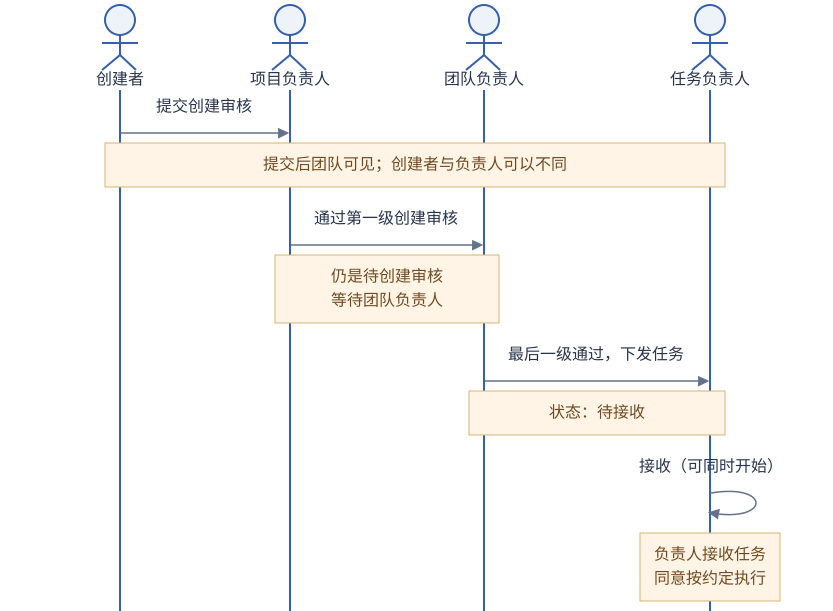

# 使用指南

[English](../en/USER-GUIDE.md)

## 角色与可见范围

团队负责人建项目、下发任务、做最终创建审批、调整已下发约定和批准清单变更。项目负责人管理项目成员，并按审批路线处理项目任务。任务负责人接受工作、报告进展、提交成果；任务验收人决定通过或退回。

任务创建者、负责人、验收人可以不同。普通成员负责项目任务时，默认验收人是项目负责人；项目负责人负责的任务默认由团队负责人验收。可以显式指定有效验收人，非团队负责人不能验收自己的任务。管理员的职责是账号管理，不能以管理员身份越过业务审批。

草稿仅创建者可见。提交后，任务对整个团队可见。项目成员列表不控制可见范围，所以不要把敏感材料当成只有项目成员能看到的内容。

## 工作区

左侧任务树按项目和父子任务组织；中间默认显示甘特图，也可切换到原任务图谱或团队更新。甘特图与任务图谱共享项目、搜索、状态和时间筛选，以及选中的任务；切换时保留各自的视图状态。任务图谱仍可缩放、拖动和定位，拖动只改变布局，不改变业务关系。选中任务后，右侧展开同一任务的约定、执行清单、进展、关联、成果和动态。待处理事项可从侧栏或底部面板按钮打开；团队更新用于查看操作历史。

### 甘特图

选择总览、日、周或月调整时间轴，用“今日”或“定位选中任务”定位；项目分组可折叠。时间按上海自然日展示，横条表示计划开始到交付期限，不代表完成百分比。同时填写两端日期时显示时间条；仅有交付期限时显示截止旗标，未设置期限时显示“待排期”，不使用创建时间补齐工期。

任务颜色沿用生命周期，未解决的阻塞和交付逾期另有提示。约定调整尚未确认时，交付逾期仍依据原已确认约定。打开“前置依赖”可查看验收前置连线；它允许后置任务提前开工，不自动排程或修改约定。

点击任务后地址包含 `?task=<UUID>`，可以复制给团队内的其他账号；访问仍遵循任务可见权限。

## 创建与接受

“新建任务”首先保存私有草稿。填清标题、预期结果、验收标准、负责人、验收人和项目。计划开始可留空；提交或下发前必须有交付期限、接收期限和下次反馈时间。界面采用上海时区，输入格式为 `YYYY-MM-DD HH:mm`。

时间既可以按 `YYYY-MM-DD HH:mm` 手输或粘贴，也可以点击日历按钮选择日期及 24 小时制的时、分，两种方式均使用上海时区。点击确认后回填；取消或按 Escape 不改变原值。清空后仍遵循原有任务必填规则。自定义时间范围也支持日历选择，但只填写日期（`YYYY-MM-DD`）。

成员在项目内创建任务，一般先经项目负责人、再经团队负责人通过创建审核。项目负责人自己创建本项目任务时直接等团队负责人；团队负责人创建任务可以直接下发。以任务详情的“等待处理人”为准。

审批完成后任务为“待接收”。负责人可选择“接收任务”后再“开始执行”，或“接收并开始”。无法接受时说明原因，由下发人处理。仅填了负责人姓名，不等于该负责人已经接受工作。

### 从草稿到完成

这张图展示交付主流程。清单完成不等于任务完成，必须由验收人通过成果。负责人拒绝接收时，任务仍停留在“待接收”，等待下发人处理；团队负责人可取消未结束的任务，已完成或已取消任务都不能重开。阻塞和“版本待确认”只是任务上另外记录的情况，不会改变任务的状态，所以图中没有它们对应的状态。

### 谁在何时处理

图中以普通项目成员创建项目任务为例，创建者和任务负责人可以是不同的人。项目负责人自己创建本项目任务时跳过第一级；项目负责人同时也是团队负责人时，也只需团队负责人审核。团队负责人创建任务可直接下发。“审批通过”是下发方的决定，“接受任务”是执行方的承诺，两者是不同动作。

## 执行清单与正式进展

负责人通过“申请清单变更”提交执行清单（每行一项），并标明这次变更是否影响范围或验收标准。未改变范围或验收标准时原因选填，否则必填。团队负责人批准后清单才生效。涉及范围的清单变更会产生新约定版本，负责人还需确认。

勾选清单项目后点击“确认提交”才会保存；未提交的勾选不会计入服务端进度。清单达到 100% 仍不会自动结束任务，必须提交成果并由验收人通过。

“提交正式进展”需要当前结果、下一步、下次反馈时间。评论适合讨论，但评论和清单勾选都不算正式反馈，也不推迟反馈期限。

## 阻塞与约定调整

“报告阻塞”填写原因、所需协助和协助人。协助人可在待办中找到任务，并在“关联与交付 → 阻塞”回复。任务负责人收到解决方案后“解除阻塞”。报告阻塞不会自动修改交付期限。

成员可“申请调整约定”；由团队负责人决定是否执行“调整约定”。变更需要原因与调整确认期限。负责人阅读差异后“确认当前版本”。确认前保留此前已接受的承诺，最终提交成果必须基于当前已确认版本。换负责人后，新的负责人需重新接收。

图中的 vN 表示已接受版本，vN+1 表示调整后的版本。换负责人时，通过“接收任务”或“接收并开始”接受新版本，无须再重复一次“确认当前版本”。若调整发生在“待验收”，原待验收成果被标为已替代，任务回到进行中，需要根据新约定重新提交成果。

## 成果与验收

负责人“提交成果”，填写可核验的文字结果、可选的 HTTP(S) 证据链接和验收期限。系统保存正文与链接，不上传文件，也不代验远程文件内容。

验收人选择“验收通过”或“验收退回”。退回必须说明缺口，并指定下次反馈时间；同一任务回到进行中。负责人补充后重新提交，原提交及退回理由仍保留。“任务内容 → 关联与交付 → 成果提交”可查看多次成果，“动态”可查谁在何时做了什么。

已完成或已取消任务不能重开。后续修复应创建新任务，再关联原任务。

## 三种任务关系

| 关系           | 用途                     | 添加方向               | 对完成的影响                                 |
| -------------- | ------------------------ | ---------------------- | -------------------------------------------- |
| 主归属（父子） | 一个目标拆成若干任务     | 在子任务中选父任务     | 子任务不会自动完成父任务                     |
| 前置依赖       | 某项成果是另一任务的前提 | 在后置任务中选前置任务 | 前置任务未通过验收时，后置任务不能验收通过   |
| 普通关联       | 保留背景或跟进联系       | 任一任务选另一任务     | 不阻止验收，也不改日期和状态                 |

两条补充说明：

- 父任务不会因子任务完成而自动完成；子任务尚未完成时，验收父任务需要验收人说明理由。
- 取消前置任务也不会解除“前置未通过验收就不能验收后置任务”这条限制。

在右侧“关联与交付 → 关系 → 添加关系”搜索标题或任务编号、选目标与关系类型并说明原因。已下发任务的关系由团队负责人维护。父子任务不能互相设置依赖，父子或依赖不能形成环路。依赖约束发生在验收通过时，并不会禁止后置任务先开始。

## 筛选与待办

标题或编号搜索、项目、状态和时间范围共同筛选任务树、图谱、匹配数量和团队动态。时间按当前计划计算，不从标题猜日期；可选择全部、本周、本月或自定义日期。

通过筛选区顶部的“**全部任务 / 与我相关**”聚焦个人职责。“与我相关”默认包含“**我负责的**”“**我创建或下发的**”“**我审批或验收的**”；展开范围摘要即可自由组合，匹配多个范围的任务只出现一次。取消全部勾选将显示零条结果。“全部任务”退出关系筛选，并在本次会话中保留所选范围，方便再次使用。

审批和验收按职责关系显示，包含尚未轮到的审批及已完成任务。范围与项目、搜索、状态和时间共同作用于任务树、甘特图、图谱及团队动态。必要的上级任务保留为上下文，不增加匹配数量。待处理事项始终可用；所选任务即使不在当前范围内，也保留详情和完整历史。

全部项目采用个人全局时间范围。项目最初跟随全局，在项目内应用范围后形成个人项目覆盖；“恢复跟随全局”移除覆盖。时间偏好按账号存到数据库；语言和主题按浏览器保存。

“包含未设置周期”和“包含此前未完成”可以补充无期限草稿与早于范围但未结束的任务。待办不受时间筛选影响。即使所选任务在当前筛选范围外，仍可查看它的详情和完整历史；为它显示的上级任务也不算新增匹配任务。

## 操作失败时

先读界面错误提示，检查权限、必填时间、当前版本与前置状态。错误请求不会变成成功操作；表单保留填写内容。遇到版本冲突，刷新最新任务，阅读变更后重试。不要把重复点击当作推进状态的方法。

下一步：[按案例完成一次交付](CASE-CSV-EXPORT.md)。
